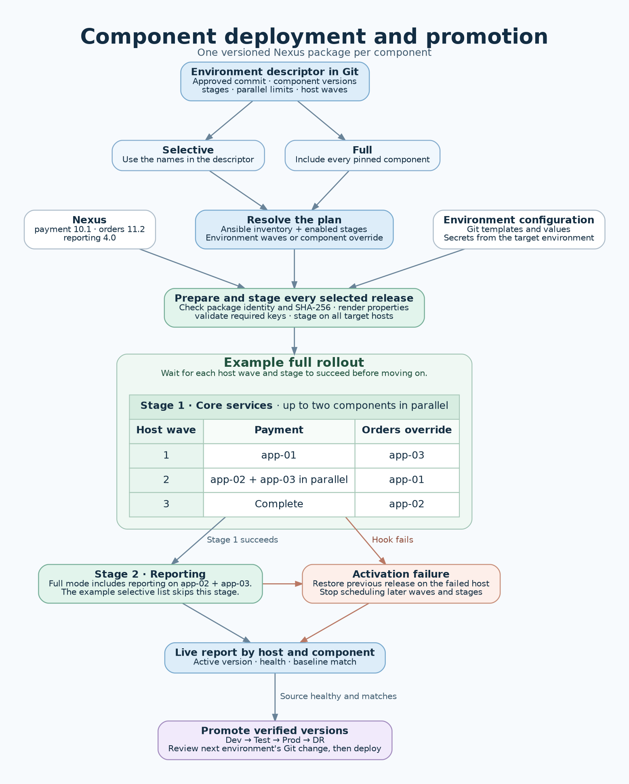

# MyApp component deployment handover

## Vendor handoff requirements

Share this section with the vendor before agreeing the release format. It defines the package, property information, and lifecycle commands our deployment consumes.

### What to deliver for each component release

| Delivery item | Required from the vendor | Acceptance check |
| --- | --- | --- |
| Component and release identity | A stable component name, such as `payment`, and an exact build version, such as `10.1`. Use the same name across releases and quote the version as a string in YAML. | The component and version in the package manifest exactly match the approved internal descriptor. The component name starts with a lowercase letter and then uses lowercase letters, digits, underscores, or hyphens. |
| Complete package | One `.tar` or `.tar.gz` per component version. Put `manifest.yml` and `payload/` at the archive root. Include all release-owned binaries, launchers, static libraries, and other files that component needs to install on a clean host. | The archive opens as a tar file. Members have normal relative paths and are regular files or directories. Packages with an extra wrapper directory, links, duplicate member paths, or special files fail acceptance. |
| Artifact metadata | Provide the intended filename or repository coordinate and the SHA-256 of the delivered bytes. We record the final Nexus path and the exact SHA-256 in our approved descriptor. Work with us to use an immutable coordinate for each published release. | Recompute the checksum from the file published to Nexus and compare it with the independently supplied checksum. |
| Required properties | Provide the destination and each required property key in the package manifest when deployment must enforce those settings. Supply a property handoff table covering required and optional settings, purpose, type, format, units, allowed values, and changes since the prior release. | The manifest uses paths relative to `payload/`. The vendor's documented application loader reads these actual paths. Every declared key is present and nonblank after we apply environment configuration. |
| Start, stop, and health | Include executable `payload/bin/start`, `payload/bin/stop` and `payload/bin/health`, each with a valid shebang for the target Linux hosts. Document what the commands do and expected timing. | We can start, inspect, and stop a clean install as the service account, repeat stop after the service is down, and demonstrate health failing for a service that is down or unready. |
| Running-version check | Supply executable `payload/bin/version` if the deployment must prove the build of the running application. | The hook prints the exact application version using the running instance, for example `10.1`. The code supports installing packages without this hook, and records the installed version from the receipt in that case. |
| Runtime and compatibility notes | State Java/runtime version, OS dependencies, ports, permissions, writable paths, required peer versions, configuration changes, migrations, and recovery constraints. Provide a supported downgrade path or the recovery procedure for incompatible migrations. | Release reviewers verify the proposed component mix, dependencies, timing and state changes before approving a deployment wave. |

### Package layout and manifest format

The example below is a single payment package. The Nexus naming convention is an example. The `artifact.path` in our descriptor must match the actual repository-relative coordinate.

```text
payment/10.1/payment-10.1.tar.gz
  manifest.yml
  payload/
    payment.jar
    bin/
      start
      stop
      health
      version
    config/
      application.properties
```

Write `manifest.yml` as a YAML mapping with these fields:

```yaml
component: payment
version: "10.1"
required_properties:
  config/application.properties:
    - db.url
    - db.password
```

- `component` and `version` are required strings. The loader compares the actual values with the approved descriptor. Quote numeric-looking versions to preserve the exact release identity, such as `"10.0"`.
- `required_properties` is optional in the file format. Include it for every Java properties file and key whose presence the deployment should enforce. Each mapping key is the component-relative destination. Each value is a YAML list of property-name strings. The check runs after our Git-based configuration overlay.
- Java property validation checks whether keys parse and have nonblank values. Your application and readiness hook still need to validate operational details such as types, connectivity and credentials.
- Use normal archive paths such as `manifest.yml` and `payload/bin/start`. Use regular files and directories. Symbolic links, hard links, devices, duplicate paths, absolute paths, traversal segments and a leading `./` are outside the supported package format.
- The packaging tree can contain placeholder files at the documented destinations. We can also create those files during deployment. Provide defaults and examples that contain placeholder values, and deliver the actual environment-specific credentials through our internal secret process.

From a staging directory containing `manifest.yml` and `payload/`, a typical packaging command is:

```bash
chmod 0755 payload/bin/start payload/bin/stop payload/bin/health
# If the running-version hook is included:
chmod 0755 payload/bin/version
tar -czf ../payment-10.1.tar.gz manifest.yml payload
sha256sum ../payment-10.1.tar.gz
tar -tzf ../payment-10.1.tar.gz
```

### Property handoff template

Submit a row for every new, changed, renamed, deprecated, or removed setting. Carry forward unchanged mandatory settings in the complete property inventory. This example uses placeholders.

| Destination relative to `payload/` | Property key | Required | Type, constraints, and units | Default or example | Secret | Change and recovery notes |
| --- | --- | --- | --- | --- | --- | --- |
| `config/application.properties` | `db.url` | Yes | JDBC URL for the supported database driver | `jdbc:postgresql://db.example.invalid:5432/payment` | No | State whether the older build accepts the same connection syntax. |
| `config/application.properties` | `db.password` | Yes | Service credential string | Placeholder | Yes | State whether downtime, overlapping credentials, or a compatibility window is needed during rotation. |
| `config/application.properties` | `http.timeout.ms` | No | Positive integer in milliseconds | `5000` | No | Include the default and any behavior change if the setting is absent. |

Tell us how the launcher selects the property file and its format. Use Java-style `.properties` for files listed in `required_properties`. XML and other static files may be installed through our configuration mappings and have a separate application-specific validation contract. Mark keys that require a restart, a migration, an external dependency, or an ordered multi-component change. Our internal team supplies the approved values and the credentials for each environment.

### Lifecycle command contract

| Hook | Expected behavior |
| --- | --- |
| `start` | Starts the requested release and returns promptly with zero when launch succeeds. A long-running process should survive the launcher returning and write its operational logs to a service-owned path. Report a nonzero exit when launch fails so recovery can begin. |
| `stop` | Stops that component instance and returns only when the process is down. It returns success when run again on a stopped instance. This supports failures during activation and retries of recovery. |
| `health` | Returns zero only when the instance can serve its intended workload. During activation we retry this check. Regular status makes one attempt per component and host. Keep the check bounded and safe to repeat. |
| `version` | If supplied, reads the version from the running process or a version endpoint and prints only the build version on stdout. A marker copied from the package cannot confirm the build of the running process. |

The host runs each hook from the release directory as the component's unprivileged service account. It provides `MYAPP_COMPONENT`, `MYAPP_COMPONENT_DIR`, `MYAPP_SHARED_DIR`, and a small environment containing `PATH=/usr/local/bin:/usr/bin:/bin`, `HOME`, `USER`, and `LOGNAME`. Resolve any extra runtime setup inside the launcher or through the site's service manager. Treat the release tree as read-only from the service account's point of view. Put PID files, logs, and writable runtime state in `MYAPP_SHARED_DIR` or an agreed application path. The helper captures the version hook's stdout and suppresses routine hook output, so preserve diagnostic logs in the application or service infrastructure.

Packages, lifecycle hooks, and the application must run with public internet egress blocked. Include release-owned dependencies in the package and declare any pre-provisioned runtime or approved internal services they require. Launchers must be self-contained in that offline boundary.

Before first production use, demonstrate an install on a clean representative host, a rerun, a readiness failure, and a supported recovery to an earlier build. Report any change that cannot be safely recovered through a component file and process rollback, especially schema and persistent-state changes.

## Guide map

1. [Architecture, ownership, and assumptions](#architecture-ownership-and-assumptions)
2. [Prerequisites and first setup](#prerequisites-and-first-setup)
3. [Configuration repository and file formats](#configuration-repository-and-file-formats)
4. [End-to-end operating procedures](#end-to-end-operating-procedures)
5. [Ansible repository and playbooks](#ansible-repository-and-playbooks)
6. [Python and shell implementation reference](#python-and-shell-implementation-reference)
7. [Testing, troubleshooting, and recovery](#testing-troubleshooting-and-recovery)
8. [How to maintain and extend the system](#how-to-maintain-and-extend-the-system)
9. [Complete shipped file index and contents](#complete-shipped-file-index-and-contents)



## Architecture, ownership, and assumptions

A release consists of independently published component packages. The vendor owns package implementation and release requirements. Application support owns the desired per-environment pins and configuration. Deployment engineering owns orchestration, inventories, CI, and the host-side release layout. Keep the config and Ansible repositories as separate GitLab projects so infrastructure and release/config changes can be reviewed by the teams that own them.

| Decision | Why it is designed this way | Consequence for the owner |
| --- | --- | --- |
| One package per component version | Selectively upgrade or recover services without republishing other components. The whole environment is described by the approved pins together. | Retain every independently pinned package. Confirm that the selected mix of component versions is compatible. |
| A complete, versioned environment descriptor | Git records desired packages, config, and rollout policy together. Restore either the whole environment or a deliberate subset. | Commit the desired state and use its SHA. Record and reconcile partial rollouts when reality differs from the descriptor. |
| Immutable package path plus digest | The path finds the package. The digest detects drift or replacement of its bytes. The manifest additionally verifies identity and version. | Protect the source of the approved checksum. The tool has no vendor-signature verification flow. |
| Git commit rather than the runner's working tree | Jobs can reproduce the same tracked templates, pins, and rollout policy. | Uncommitted edits are absent from the snapshot. A historical release also depends on retained artifacts and the intended external secret versions. |
| Config and secrets owned internally | The vendor defines the keys. The internal environment supplies non-secret settings and secret values. | Resolve the necessary secrets before the job. Rotating a value requires a new `secret_revision` to obtain a new release identity. |
| Prepare and stage before any activation | Download, package, config, and transfer errors can be found while the old application is still active. | Budget enough disk and time for the package, transfer, and old and new release trees. |
| Stage order and wave barriers | Give operators explicit control over application order, parallelism, and canary hosts. | Define compatible components and correct host aliases. The scheduler has no automatic dependency discovery or cluster traffic management. |
| Shared per-environment lock plus per-component host lock | CI serializes jobs for the environment, and the host serializes operations on a component. | Coordinate Jenkins and out-of-band runs with the same operational lock when they share targets. GitLab resource groups are scoped to the deployment project. |
| Atomic `current` link and retained releases | A local rollback can select an existing previous release quickly without copying its files again. | Use a Linux filesystem and compatible release layout. Data/schema recovery and rollback of successfully updated peers require their own procedures. |
| Live status as promotion evidence | The source must be running the approved selection and pass health checks before its pins move forward. | A promotion only writes a candidate. Merge and deploy in the next environment with its own settings. |

The shipped environments are `dev`, `test`, `prod`, and `dr`. Their demo deployment root is `/opt/myapp`. The sample uses three Linux aliases per environment, one `myapp` service account, and separate groups for payment, orders, and reporting. The same physical host can run several independent components. For isolation, use separate service accounts and primary groups as required by your workloads. If two environments share hardware, give them distinct targets or release roots and coordinate the different CI locks.

| Approved demo pin | Dev | Test | Prod | DR |
| --- | --- | --- | --- | --- |
| Payment | `10.1` | `10.0` | `10.0` | `10.0` |
| Orders | `11.2` | `11.1` | `11.1` | `11.1` |
| Reporting | `4.0` | `4.0` | `4.0` | `4.0` |

The examples assume a target with an existing supported runtime, an approved direct Nexus HTTPS repository, and a trusted GitLab project and runner. They omit machine provisioning, load-balancer draining, database migrations, secrets version storage, and external backups. Local verification uses fixture shell hooks and temporary directories in place of real applications and infrastructure.

## Prerequisites and first setup

| Location | What must already exist | Used by |
| --- | --- | --- |
| Controller or GitLab runner | Linux with Bash, Git, OpenSSH, Python 3.12, the project Python dependencies and access to the correct config checkout and inventory. Pre-provision system tools and install the Python dependencies from the approved internal Nexus wheel archive. | All commands. Deploy and status need Ansible and valid SSH connections for real targets. |
| Managed host | A Linux account for SSH with access to the deployment root and permitted privilege escalation where used. `/usr/bin/python3` must be available and supported by Ansible Core 2.19. Install util-linux for `runuser` when switching users, the site's Java/runtime and any binaries the vendor hooks use, and the service account with its primary group. | Stage creates/chowns directories. Activate invokes hooks as the service account. Status reads release metadata and invokes checks. |
| SSH | Trusted host keys in the runner's `known_hosts`, correct host aliases and address mapping, and an accepted private key or site-configured SSH credential. Configure sudo as appropriate to reach the deploy root and change ownership. | Ansible plays and the selected inventories. The shell integration tests use local connection instead. |
| Nexus | Hosted internal wheel and vendor repositories, direct HTTPS, trusted internal CA, immutable paths, retention, and optional paired Basic credentials. | Every CI job bootstraps Python from Nexus. Deploy and rollback also fetch the selected vendor packages. |
| Config GitLab project | Committed descriptors and mapped files on its default branch, code review rules, and deployment-project job-token read access. | CI checkout, default-branch ancestor check, and the controller's config snapshot. |
| Ansible GitLab project | Protected default branch, trusted runner and web/manual pipeline permissions. Configure production and DR environment approvals and protected variables at the GitLab instance. | CI operation jobs. The declaration uses GitLab's environment machinery. Policy and actual approvers are configured in GitLab. |
| Secret provider | Target-scoped `MYAPP_SECRET_*` bindings, SSH file variables for CI, and the required externally managed secret versions for rollback. | Payload rendering and remote access. |

### Offline supply chain and runner setup

Use a protected **GitLab shell runner** tagged `myapp-offline`. Assign this tag exclusively to shell runners provisioned with Linux, Python 3.12 with `venv` and bundled pip, Bash, Git, OpenSSH, util-linux, coreutils, and the internal CA. Use the same pre-provisioned tooling for Jenkins or local administration. The project uses Ansible built-ins and needs no separate collection or role downloads.

| Connection | Permitted internal purpose |
| --- | --- |
| Runner → GitLab | Check out the deployment project, fetch the approved config project and publish artifacts. Configure GitLab and any artifact storage to stay internal. |
| Runner → Nexus | Fetch the approved wheel archive and immutable vendor archives using direct HTTPS. Place both in hosted repositories fed by the internal supply process. |
| Runner → deployment hosts | SSH and Ansible operations, using internal DNS and trusted host keys. |
| Runner, Nexus, and application or host network policy | Enforce default-deny public egress. Permit only approved internal paths including internal DNS and any application dependencies. This covers the runner's initial source checkout, Nexus service, and independently supplied application and vendor hook code. |

Publish the wheels for the complete Python controller dependency set to an internal Nexus raw hosted repository. Include exactly one compatible wheel for each installed distribution, with every required transitive dependency. Select wheels for the runner's OS, CPU, Python, and native ABI. The following packaging step uses an already approved local wheel directory. Publish the tar and its independently reviewed checksum through your internal Nexus process:

```bash
cd /path/to/approved-wheels
tar -czf ../myapp-python312-wheelhouse-001.tar.gz -- *.whl
sha256sum ../myapp-python312-wheelhouse-001.tar.gz
```

The archive contains only regular `.whl` files at its root, with no wrapper directory or source distributions. Use versioned, immutable Nexus paths. Python's bundled pip creates the venv locally. The bootstrap uses an explicit list of local wheel paths, disables package indexes, dependency fetching and pip version checks, clears inherited pip settings, validates the constrained requirements, and runs `pip check`. If a wheel or dependency is missing, incompatible, or outside the approved requirements range, republish a corrected wheel archive through the internal approval process.

Set these variables at the runner or project boundary, with values from your infrastructure:

| Variable | Value |
| --- | --- |
| `MYAPP_NEXUS_AUTHORITY` | Exact approved Nexus hostname and optional port. The downloader requires both wheel and vendor URLs to match it. |
| `MYAPP_NEXUS_WHEELHOUSE_URL` | Direct internal HTTPS URL of the approved wheel archive. Required before every CI job, including checks. |
| `MYAPP_NEXUS_WHEELHOUSE_SHA256` | Lowercase SHA-256 of the wheel archive. Required before every CI job. |
| `MYAPP_NEXUS_WHEELHOUSE_USER`, `MYAPP_NEXUS_WHEELHOUSE_PASSWORD` | Optional paired Basic authentication credentials for wheelhouse downloads. If access requires credentials, scope these so check jobs can read them too. |
| `MYAPP_NEXUS_BASE_URL` | Direct internal HTTPS base URL of the hosted vendor repository. Required for deploy and rollback when reading from Nexus. |
| `MYAPP_NEXUS_USER`, `MYAPP_NEXUS_PASSWORD` | Optional paired Basic authentication credentials for vendor artifacts. |
| `MYAPP_GITLAB_AUTHORITY` | Exact approved internal GitLab hostname and optional port expected in `CI_SERVER_URL`. Required for CI operation jobs. |

The network helper rejects URL credentials, queries, fragments, wrong authorities, and non-HTTPS requests. It uses system TLS trust, ignores automatic proxy configuration and refuses redirects. The secondary Git clone checks the GitLab authority, verifies TLS, disables redirects and automatic proxy configuration, and clones without submodules. The CI source checkout skips submodules and LFS materialization. Public egress enforcement belongs to the runner, Nexus and target network policies.


### Bring-up procedure

1. Extract both ZIPs and import their root directories into separate GitLab repositories. Commit each tree. The working directory layout in CLI examples assumes the two repositories sit next to one another.
2. Add the approved Linux targets to `inventories/<environment>/hosts.yml`. Match the aliases in that environment's `deployment.yml`, including component overrides. Create the target accounts and test actual SSH, Python and sudo access.
3. Replace the example package coordinates and checksums with actual immutable vendor artifacts. Replace the demo database endpoints and review every file mapping with application support. The sample names under `example.invalid` are placeholders.
4. Configure the project's secrets, CA trust, host keys and GitLab access. A real deployment uses credentials from its environment scope. Configure the same environment lock or an agreed exclusion procedure for any Jenkins or direct execution path.
5. Run local checks, plan a dev rollout, review the exact host waves, and deploy a representative component. Check the report and application readiness. Promote with the agreed sequence when the dev rollout is verified.

```bash
cd myapp-component-ansible
python3.12 -m venv .venv
source .venv/bin/activate
# Export the approved Nexus wheelhouse variables before this command.
python tools/bootstrap_python.py

config=../myapp-component-config
ref=$(git -C "$config" rev-parse HEAD)
export MYAPP_NEXUS_BASE_URL=https://nexus.corp.example/repository/vendor-releases
python tools/deploy.py validate --environment dev --config-repo "$config" --config-ref "$ref"
python tools/deploy.py plan --environment dev --config-repo "$config" --config-ref "$ref"
```

For direct CLI runs, `HEAD` is a convenient way to resolve the reviewed commit you checked out. Supply the intended full SHA explicitly for deployment and recovery. Provide the Nexus username and password together when using Basic auth and bind component secret variables through your approved credential provider. The deployment account expects the managed component `current` path to be absent on first install or already be a symlink created by this tool. Plan the migration of any existing unmanaged service and PID files before first cutover.

## Configuration repository and file formats

### How to read the shipped formats

| Format or extension | How this implementation reads it | Authoring rules |
| --- | --- | --- |
| YAML `.yml` | PyYAML loads descriptors, values, and vendor manifests as mappings. Ansible interprets inventory, playbooks, and play vars. GitLab interprets `.gitlab-ci.yml`, including its `!reference` extension. | Use spaces for indentation and unique keys. Indentation creates nested maps and `-` starts a list item. Use `[]` for an inline list and `{}` for an empty map. Quote numeric-looking versions and business values that must stay strings. The parser performs code-level validations rather than loading a separate schema file. |
| `.properties.j2` | Controller-side Jinja2 template. It renders text into a Java properties file after environment values and secrets are combined under `settings`. | Save template text as UTF-8. Each Java property uses `key=value`. Apply `java_property` to inserted Java property values so spaces, separators, backslashes or other special characters are escaped coherently. Undefined variables raise a preparation error. |
| `.xml` | Static byte-for-byte copy for the sample `logback.xml`. The Java application or logging library owns XML interpretation. | Maintain well-formed XML and update the mapping if the application's loader uses another relative location. There is no XML schema or Logback runtime validation in the controller. |
| `.py` and `.pyz` | Python 3 source on the controller. The host helper is packaged as a zipapp with `__main__.py` and `archive.py`. | Run the controller with its installed Python dependencies and the host zipapp using `/usr/bin/python3`. Keep host code within the managed-node Python support range. |
| `.sh` and extensionless vendor hooks | Bash runs the CI and test scripts. The host executes each vendor hook by path using its shebang. | Use Linux line endings and a target-available interpreter. Invoke shipped scripts with `bash` as documented. Set executable bits on vendor hooks in the archive. |
| `.cfg` | Ansible's INI configuration for the project. | Settings under `[defaults]` use `key = value`. Run from the project directory so the intended config is picked up. The controller sets its subprocess working directory to the project. |
| `requirements.txt` and `.gitignore` | The offline bootstrap checks pip dependency specifiers against approved wheel contents. Git reads ignore patterns relative to the repository. | Review compatible dependency bounds together. Ignore patterns cover local noise and common conventional secret filenames and do not screen content committed under another name. |
| `.tar`, `.tar.gz`, and delivery `.zip` | The vendor artifact is a tar archive. The controller also emits a transport tar and a Git snapshot tar. The two ZIP downloads package the source projects for import. | Give Nexus the per-component tar. Unpack the source ZIPs into Git project directories. Preserve the vendor hook executable bits when constructing the tar. |
| `.json` | Controller and host use JSON for Ansible extra vars, deployment receipts, the activation journal, plan output, and status reports. | Use JSON serialization so booleans, strings, lists, and null values remain typed. Runtime files are owned by their writers. Make operational changes in the descriptor instead of manually editing receipts. |
| `.md` and `.png` | Markdown provides README and handover text. The PNG is the standalone rollout diagram. | Keep the guide and diagram alongside one another for the relative Markdown image link. These files have no runtime role. |

### Configuration project root files

`.gitignore` supplies Git patterns for `*.local`, `*.secret`, and `.env`. It needs no application runtime. It only affects Git's treatment of untracked files. Use the external secret provider for sensitive configuration.

`README.md` is the application support quick reference. It describes ownership, descriptor policy, configuration setup, and propagation of a package pin through promotion. Update this README when the config contract changes. The approved environment files, referenced by the selected commit, are the inputs the controller reads.

### Environment descriptors

The four files are `envs/dev/deployment.yml`, `envs/test/deployment.yml`, `envs/prod/deployment.yml`, and `envs/dr/deployment.yml`. Each contains the whole desired environment. Dev demonstrates newer payment and orders pins. The other descriptors demonstrate separate approval and promotion, use their own host aliases and config directories, and start on older pins. All four default to selective deployment of payment and orders. Full mode adds reporting.

```yaml
environment: dev
deployment:
  mode: selective
  selective:
    components: [payment, orders]
  full:
    components: all
  stages:
    - name: core-services
      components: [payment, orders]
      max_parallel: 2
    - name: reporting
      components: [reporting]
      max_parallel: 1
  host_waves:
    - [dev-app-01]
    - [dev-app-02, dev-app-03]
```

| Descriptor field | Required, allowed values, and behavior |
| --- | --- |
| `environment` | Required string, matching the command and its directory. The application supports `dev`, `test`, `prod`, and `dr`. |
| `deployment.mode` | Required `selective` or `full`. Default for plan, validate, deploy and promote. Status defaults to full coverage. CI rollback defaults to selective independently. |
| `deployment.selective.components` | Required nonempty list of unique known component names. Selective uses the list or an explicit CLI override. This list determines scope. Stage order determines activation order. |
| `deployment.full.components` | Must be the literal string `all`. Full mode selects every catalog entry. |
| `deployment.stages` | Required ordered nonempty list of stage maps. Each stage needs a unique nonempty string `name`, nonempty `components` list, and positive integer `max_parallel`. Across stages, every catalog component must occur exactly once. |
| `deployment.host_waves` | Required ordered list of nonempty alias lists. Each alias in the union of all catalog groups must occur exactly once. Use inventory host aliases, even when `ansible_host` differs. |
| `components` | Required nonempty map from stable component names to entries. A component name uses `[a-z][a-z0-9_-]*`. |
| `components.<name>.group` | Required Ansible group. Its name begins with a letter or underscore and can contain letters, digits, and underscores. It must resolve to a nonempty target set. |
| `components.<name>.service_user` | Required matching Linux account name, beginning with a lowercase letter or underscore. The descriptor rejects the literal `root`. The host uses the account's UID, GID, and home. |
| `components.<name>.hook_timeout` | Optional positive integer in seconds, default `30`. Each hook call has its own timeout. |
| `components.<name>.health_retries` | Optional positive integer, default `10`. Number of verification attempts during activation and recovery. Status always attempts once. |
| `components.<name>.health_delay` | Optional nonnegative integer in seconds, default `3`. Delay between failed attempts. |
| `components.<name>.artifact.version` | Required nonempty string. Must exactly match the package manifest. |
| `components.<name>.artifact.path` | Required safe relative path inside the Nexus repository or local package directory. Keep the full package filename in the path. |
| `components.<name>.artifact.sha256` | Required 64 lowercase hexadecimal characters representing the entire archive. |
| `components.<name>.config` | Required map for every component that is planned. It may be empty if there is no environment overlay. Its optional `values` and `files` fields are explained below. |
| `components.<name>.host_waves` | Optional replacement for that component's inherited waves. Lists every member of its own group exactly once. |

The scheduler validates stage coverage, inventory groups, and host wave coverage across the whole catalog, even during a selective run. It resolves config mappings for the selected entries. Host aliases must start with an alphanumeric character, may then use alphanumeric characters, underscores, dots or hyphens, and cannot match a group name.

### Configuration values and file mappings

Each environment has subdirectories for `payment`, `orders`, and `reporting` under `envs/<environment>/files/`. Each has three authored files.

- **`values.yml`** is a YAML mapping. `parameters` maps Jinja setting names to strings. `secret_env` maps other setting names to runner environment variable names matching `MYAPP_SECRET_[A-Z0-9_]+`. The maps cannot declare the same setting name. When `secret_env` is nonempty, a nonempty string `secret_revision` is required. The runner must supply each declared variable with a nonempty value when preparing a deployment.
- **`application.properties.j2`** maps the internal settings `db_url`, `db_password`, and `timeout_ms` to the vendor-facing keys `db.url`, `db.password`, and `http.timeout.ms`. Source is read from Git and target is produced on the controller. Link new vendor requirements to the corresponding template and values change.
- **`logback.xml`** defines a console appender, a pattern with time, log level, logger and message, and an INFO root level. All shipped environments use identical content, but the descriptor locates each environment's own copy. Change that environment's XML when its logging policy differs.

Example `values.yml` and its mapping:

```yaml
parameters:
  db_url: "jdbc:postgresql://dev-db.example.invalid:5432/payment"
  timeout_ms: "5000"
secret_env:
  db_password: MYAPP_SECRET_PAYMENT_DB_PASSWORD
secret_revision: "1"
```

```yaml
config:
  values: envs/dev/files/payment/values.yml
  files:
    - source: envs/dev/files/payment/application.properties.j2
      destination: config/application.properties
      action: template
    - source: envs/dev/files/payment/logback.xml
      destination: config/logback.xml
      action: copy
```

`source` and `values` are relative to the configuration repository and must begin with `envs/<target>/`. `destination` starts inside the component payload. Destinations must be distinct and cannot replace the receipt or any `bin` path. A `template` action reads the bytes as text and renders with strict undefined-variable checks. A `copy` action installs the source bytes directly. Overlay files are created with mode `0640`. The release directories, archives, and transport data can contain rendered secrets. The report and receipt store provenance fields instead of rendered configuration.

The config fingerprint hashes a canonical JSON representation of the parsed values document, paths, rules, and a SHA-256 of each mapped file's bytes. The release ID adds the environment, component name, and entire artifact mapping. The approved Git SHA is also recorded separately in receipts and reports. The fingerprints do not contain actual runner secret values. Update `secret_revision` with secret rotation to cause a new release ID. An unrelated Git commit, topology change, or hook timing change does not itself create a new release ID. A deployed receipt can retain its original config commit when later commits lead to an identical release ID.

## End-to-end operating procedures

### CLI actions and options

| Command or option | How it behaves |
| --- | --- |
| `plan` | Resolve the descriptor, selected package metadata, config fingerprints, valid inventory groups and exact waves. Prints JSON and performs no downloads or host plays. |
| `validate` | Performs the same planning work and prints a short confirmation. It does not verify remote access, the Nexus contents, or runtime secrets. |
| `deploy` | Prepare and stage every selected package, activate in ordered waves, collect status, and return nonzero if deployment fails or any selected row is unhealthy or mismatched. Manual rollback uses this same action with a restore commit. |
| `status` | Calculate expected IDs and query live hosts. Defaults to full environment scope. Returns zero when all selected rows are healthy and match. |
| `promote` | Run the source status gate, then generate the next environment's descriptor candidate. |
| `--config-repo PATH` | Required path to a local Git checkout of the config repo. |
| `--config-ref REF` | Ref or SHA to resolve to a commit. The local default is `HEAD`. CI requires a full SHA reachable on the config default branch. |
| `--environment ENV` | Required environment. Selects default inventory and descriptor. In promotion, this is the source. |
| `--mode selective\|full` | Override the command's default scope for one invocation. |
| `--components NAME[,NAME...]` | Replace the descriptor selection for a selective invocation. Names must be unique and exist in the descriptor. Whitespace around names is trimmed. Stage order still comes from the descriptor. |
| `--inventory PATH` | Override `inventories/<environment>/hosts.yml`. Used for local testing and controlled alternative inventories. The descriptor must match that inventory. |
| `--package-dir PATH` | Read the same relative artifact paths from local disk. Verifies the same checksums. Used by tests and approved offline copies. |
| `--report PATH` | Write aggregated JSON to this path. The default is `reports/status.json` relative to the invocation directory. Use distinct paths to retain separate local reports. |
| `--to ENV` and `--output PATH` | Required for promotion. Choose the adjacent target and candidate YAML output file. |

### Deployment from source to live state

1. **Resolve the approved inputs.** GitLab checks out the config repository and validates the SHA against its default branch. The controller resolves the requested ref and uses `git archive` to build a private snapshot of tracked files. It reads the environment descriptor and asks `ansible-inventory --list` for group membership.
2. **Validate scope and compute the plan.** Apply the declared or overridden mode. In selective mode, filter stage components and drop empty stages. Match host wave aliases to component groups and calculate the desired release IDs. `plan` and `validate` stop here.
3. **Prepare all selected payloads.** Download the packages by their Nexus paths or read local fixtures. Check the SHA-256, unpack into private temporary folders, validate `manifest.yml`, copy `payload/`, layer the target config, check properties, and write the release receipt. Transport only the resulting component tree.
4. **Stage all selected payloads.** Ansible sends each transport tar to a private location per host and invokes the helper to install under `releases/<release-id>`. This happens for every selected component before any activation begins. Prepare or staging failures can leave partial staging on disk while the old active versions continue running.
5. **Activate in bounded batches.** Take one stage at a time and one numbered host wave at a time. Run up to `max_parallel` component playbooks together. Within a component's wave it uses the exact assigned aliases and enough Ansible forks for those hosts. Larger lists are split into batches, each of which finishes before another is queued.
6. **Switch and verify each installation.** Lock the local component, record the previous target in `.activation.json`, stop the previous release, replace `current` atomically, start the new release and verify readiness/version. If the exact ID is already active and healthy, the host skips its restart. The temp link and its final destination share the same filesystem.
7. **Query the intended scope and report.** After rollout or most failures in rollout, gather one live result per expected host/component, add baseline comparisons and write the report. Validation failures before planning completes can exit without a report.

### Decide deployment and host order

A component with no override inherits the environment list, intersected with its Ansible group. The controller keeps the indexes of empty intersections. A component-specific list replaces that component's inherited list. A stage waits for every active component in its numbered wave before advancing. Each stage starts its wave numbering again.

| Stage | Wave | Payment | Orders | Reporting |
| --- | --- | --- | --- | --- |
| Core services | 1 | `dev-app-01` | `dev-app-03` using its override | |
| Core services | 2 | `dev-app-02` and `dev-app-03` concurrently | `dev-app-01` | |
| Core services | 3 | Already complete | `dev-app-02` | |
| Reporting | 1 | | | Empty after inventory intersection |
| Reporting | 2 | | | `dev-app-02` and `dev-app-03` concurrently, if selected |

To finish one component across all its hosts before another starts, place them in separate stages. To serialize components inside each wave, use `max_parallel: 1`. To use strict order across hosts, put one host in each wave. To enforce a common canary position for components, give them a shared environment wave list and review any overrides. A component starting on a different physical host in the same wave is intentional in the example. The scheduler does not follow dependencies automatically. Choose your set of compatible components before executing a selective plan.

```bash
python tools/deploy.py plan --environment dev --config-repo "$config" --config-ref "$ref" --mode selective --components payment
python tools/deploy.py deploy --environment dev --config-repo "$config" --config-ref "$ref"
python tools/deploy.py deploy --environment dr --config-repo "$config" --config-ref "$ref" --mode full
python tools/deploy.py status --environment dev --config-repo "$config" --config-ref "$ref"
```

### Read disk state and report fields

```text
/opt/myapp/payment/
  current -> releases/<release-id>
  releases/<release-id>/.deployment.json
  releases/<release-id>/bin/
  releases/<release-id>/config/
  shared/
  .lock
  .activation.json
```

| Runtime file | Writer and interpretation |
| --- | --- |
| `current` | Host helper. Must be a relative symlink matching `releases/<64-character lowercase SHA-256>`. The helper creates a temporary link and replaces `current`. A normal pre-existing directory named `current` is unsupported. |
| `releases/<release-id>/` | Host staging. It is unpacked into a temporary sibling and renamed into place. Executables and directories get `0750`, non-executables `0640`, and the service account's primary group is assigned. Existing release IDs are reused after reading their receipts. |
| `.deployment.json` | Controller includes it in the payload. Contains `component`, `environment`, `component_version`, `nexus_path`, `package_sha256`, `config_commit`, `config_fingerprint`, `release_id`, and optional `ci_job` URL. |
| `.activation.json` | Host helper records `{"previous": "<release-id>"}`, or null for first install. Created before switching, removed after success or successful rollback. A remaining journal marks recovery work. |
| `.lock` | Host helper uses an advisory exclusive lock for stage, activate, and status of an existing component. |
| `shared/` | Host helper creates it, owned by the service user. Vendor hooks use it for writable state across releases. An existing directory is reused without changing ownership. |
| `reports/status.json` | Controller writes `environment`, `baseline_commit`, and `components` rows. Each row includes `host`, `component`, `state`, `expected_release_id`, and `matches_baseline`. A reachable host with an active release also contributes the receipt fields and a `running_version` if the hook returns it. |

| Status observation | Meaning |
| --- | --- |
| `healthy` with `matches_baseline: true` | The active ID matches the requested one and hooks verified health. |
| `healthy` with `matches_baseline: false` | The active installation still passes health, but holds a different approved state or configuration. A recovered failed deploy can show this outcome. |
| `unhealthy` | The health or optional running-version check failed. |
| `absent` | The helper found no active release. A fully fresh host normally starts here. |
| `unknown` | Ansible delivered no usable host result. Check authentication, sudo, Python, unreachable hosts or unusable helper output. |
| `activation_interrupted` | The helper found a pending journal, even if the current release looks healthy. A later activation attempts recovery. |
| `running_version: null` | No successful version hook value was available. Use the state and `component_version` receipt to distinguish active file identity from runtime evidence. |

### Generated controller and transfer files

| Generated path | Format and origin | Purpose and lifecycle |
| --- | --- | --- |
| `.config-repo/` | Git clone written by `tools/ci_checkout.sh`. | CI reads the approved ref from this clone. Direct CLI runs use the operator-provided checkout. |
| `config.tar` and `config/` | Git archive and its extracted files in the controller's private invocation directory. | Snapshot the approved config tree and give the controller a local directory to validate. |
| `<package-sha256>.tar` and `<package-sha256>/` | Downloaded or locally copied package bytes and extracted vendor tree. | Verify bytes before extracting and reuse the package during one invocation. The temporary filename is keyed by checksum. |
| `payloads/<component>/` and `payload-<component>.tar` | Prepared component directory and private transport tar. | Contain the selected payload, rendered settings and receipt. Ansible transfers this tree to the intended group. |
| `myapp-host.pyz` | Zipapp containing `__main__.py` and `archive.py`. | Runs shared lifecycle and extraction logic on each host using its Python. |
| `ansible-input.json` | Generated extra-vars object in a different temp directory per play. | Supplies the paths and keys such as `component_group`, `component_user`, `release_id`, `host_tool`, and per-play payload or status paths. Inventory supplies host-specific defaults. |
| `payload.tar` under the remote temporary directory | Mode `0600` copy of the component transport tar. | Used by the remote stage action. Ansible attempts to remove the enclosing directory after staging or a task failure. |
| `<sha256-of-alias>.json` | Per-host result file delegated to the controller. | Avoids filename collisions and lets the controller align observations with every expected alias. Individual files are temporary. |
| `reports/candidate/envs/<target>/deployment.yml` | Full YAML target descriptor written by the GitLab promotion job. | A review artifact. Apply the intended package pins through the config project to approve the target deploy. |

The controller uses a temporary work directory for a single invocation and normally discards it when the command ends. Treat prepared payloads and transport files as sensitive because they contain resolved application settings.

### Roll back automatically or from GitLab

Automatic rollback is local to the failing component on the failing host. If a hook reports failure or the health retries are exhausted, the helper reads the journal, stops the selected instance, restores the previous link, and starts and verifies its release. On a first install there is no previous instance to restart, so recovery removes the attempted link after stopping it. The operation still fails and later waves/stages are withheld. Work already running in the current parallel batch can finish. Earlier successful installations can stay on their new versions.

Use the manual job for a chosen restore point or wider recovery. Start a GitLab web pipeline from the deployment project's protected default branch with these inputs, then run **rollback**:

```text
OPERATION=rollback
DEPLOY_ENV=prod
CONFIG_PROJECT_PATH=platform/myapp-component-config
ROLLBACK_CONFIG_REF=<approved-config-commit-sha>
ROLLBACK_MODE=selective
ROLLBACK_COMPONENTS=payment
```

The restore SHA must be in the config project's default branch history. Leave `ROLLBACK_COMPONENTS` blank to use the restore descriptor's selective scope, or set `ROLLBACK_MODE=full` with a blank component override to load the whole restore descriptor. If current inventory or groups differ from the historical revision, prefer a reviewed revert based on current topology that restores the relevant artifact pins and configuration. Local CLI equivalent:

```bash
python tools/deploy.py deploy --environment prod --config-repo "$config" \
  --config-ref "$restore_ref" --mode selective --components payment
```

The rollback job acquires the same environment resource group and applies the same approvals, staged rollout and health checks. If the restored build fails during this attempt, automatic recovery tries to bring back the release active just before the attempt. Use the report to confirm all requested rows. If restoring a historical SHA directly, merge the intended pins and config to make the restored state the desired baseline for future operations. Keep usable historical Nexus packages and secret versions. Recover persistent data and database migrations separately.

### Promote a verified release

Run promotion against the same approved source config snapshot that describes the live release. The route is dev → test → prod → DR.

```bash
python tools/deploy.py promote --environment dev --to test \
  --config-repo "$config" --config-ref "$ref" --output reports/test-deployment.yml
```

Promotion checks every selected source host/component pair. It proceeds only when the active release IDs match and health passes. In the target YAML it copies the selected `artifact` maps. It preserves the target's host waves, group assignment, remaining package pins, and configuration. It validates the target config mappings for those components. Target package preparation, secret resolution and health happen at target deployment time. The command writes YAML to a candidate file. GitLab stores it under `reports/candidate/envs/<target>/deployment.yml`. An operator reviews and merges selected changes into the config repo and deploys the target with the merged SHA. If the target advanced since the candidate was prepared, apply only the intended pin changes to the current descriptor and re-review.

### Rebuild in disaster recovery

Provision clean hosts, approved inventory, credentials, networks and external state. Recover the config repo, old and new packages referenced by the DR baseline, and the intended DR secrets. Plan and deploy full scope using the approved DR SHA. The controller prepares each component from its own version pin. Check every host/component row in the full status report and validate application-level access. When recovery must reproduce a known mixed rollout, use a reviewed descriptor that records the intended mix from the last verified report.

## Ansible repository and playbooks

### Root files and runner requirements

| File | Contents and immediate requirements | How it changes the flow |
| --- | --- | --- |
| `.gitignore` | Four Git ignore patterns for `.venv/`, `.config-repo/`, `reports/` and `__pycache__/`. Git consumes it when listing changes. | Keeps generated files out of repository reviews. Update it when introducing a new local output directory. |
| `README.md` | Short human quick start in Markdown. It documents supported setup, commands, promotion, the GitLab rollback job, Jenkins usage, and tests. | Update it when a public command, required secret or GitLab input changes. This handover provides the detailed reference. |
| `requirements.txt` | Pip constraints for `ansible-core>=2.19,<2.20`, `Jinja2>=3.1,<4`, `PyYAML>=6,<7`, and `javaproperties>=0.8,<1`. The controller supplies these constraints to the offline bootstrap after it installs the approved wheel set from Nexus. | Ansible handles inventory and remote plays. Jinja renders config. PyYAML reads and writes structured descriptors. Javaproperties escapes and validates installed Java property settings. This file bounds dependency versions and is not a lockfile. |
| `ansible.cfg` | INI defaults `host_key_checking = True`, `retry_files_enabled = False`, and `interpreter_python = auto_silent`. | Requires known host keys for SSH, avoids stale retry files, and lets Ansible discover its module Python without routine warnings. The script tasks explicitly launch the zipapp with `/usr/bin/python3`. |

### Inventory inputs

Each `inventories/<environment>/hosts.yml` is an Ansible YAML inventory, with shared settings under `all.vars` and component groups under `all.children`. The files are used by `ansible-inventory` before the controller prepares any selected component and by every subsequent play.

| File | Alias and group content | Change impact |
| --- | --- | --- |
| `inventories/dev/hosts.yml` | `dev-app-01`, `dev-app-02`, `dev-app-03`. Payment and orders target all three. Reporting uses 02 and 03. | Controls dev operations and the live source proof for dev → test. |
| `inventories/test/hosts.yml` | `test-app-01`, `test-app-02`, `test-app-03`. Payment and orders target all three. Reporting uses 02 and 03. | Controls the test rollout and live proof for test → prod. |
| `inventories/prod/hosts.yml` | `prod-app-01`, `prod-app-02`, `prod-app-03`. Payment and orders target all three. Reporting uses 02 and 03. | Controls production deployments, rollback, and source proof for prod → DR. |
| `inventories/dr/hosts.yml` | `dr-app-01`, `dr-app-02`, `dr-app-03`. Payment and orders target all three. Reporting uses 02 and 03. | Controls DR status and clean-host restore. |

`deploy_root` is the managed filesystem base. `deploy_become: true` allows remote tasks to run with privilege escalation. `ansible_user` identifies the SSH account. `ansible_host` maps an inventory alias to a real address. The other groups can refer to the same aliases using `{}` so the connection details need to be declared once. If group membership changes, change the descriptor waves in the config repo too. A blank group is invalid. Use distinct host aliases and avoid aliases that shadow an inventory group.

### Playbooks and shared variables

All three plays use a component-specific `hosts` pattern, skip fact gathering, and compute `become` from inventory. The controller supplies generated extra vars in a temporary JSON file. Run normal operations through the CLI so the helper, payload, variables, host limit and report directories exist.

| File | Required data | Steps and reason |
| --- | --- | --- |
| `playbooks/vars/host.yml` | `deploy_root` from inventory. The plan supplies `component_name`, `component_user`, `hook_timeout`, `health_retries`, and `health_delay`. | Builds the common argument string. `>-` folds YAML lines into a single shell argument string. The root, name and service-user fields pass through Ansible's shell quoting filter. |
| `playbooks/stage.yml` | Component group, helper path, release ID, shared helper args, and `component_archive` on the controller. The target account needs write and ownership permissions in the deployment root. | Creates a temporary directory, copies `payload.tar` with `0600` and with diffs and task log suppressed, runs `stage` through the zipapp, reads the helper's JSON `changed` flag, and attempts removal in the `always` block. The transfer directory can remain after interruption or loss of connection. `any_errors_fatal` and the controller's phase barrier stop activation when staging fails. |
| `playbooks/activate.yml` | Staged release ID, helper path, shared args, reachable target hosts, and the controller's wave-specific `--limit`. Vendor hooks must work for both current and requested releases. | Calls the helper's `activate` operation and uses its JSON `changed` result. `any_errors_fatal` fails the play on a host error. The controller prevents subsequent batches/waves when it sees a failed process. |
| `playbooks/status.yml` | Helper path, component group, shared args, and a writable controller-side `status_dir`. Targets must have the service account even for an absent release. | Calls the helper's `status` operation, then delegates a local `copy` to `localhost`. The result is written mode `0600` under a hash of the inventory hostname, using the controller Python with no local escalation. The collector combines these files and marks missing results unknown. Status can create/open a lock under an existing component root and runs vendor health checks. |

### GitLab pipeline and variables

`.gitlab-ci.yml` selects a pre-provisioned shell runner tagged `myapp-offline`. Its setup creates a venv using the local Python interpreter and runs the Nexus-only wheel bootstrap. The `check` stage compiles Python, runs offline guards and scheduler tests, and executes a local Ansible integration test. Real operations run in the `operate` stage once checks pass.

| Pipeline block | Prerequisites and behavior |
| --- | --- |
| `check` | Requires the test fixtures, Bash, Git and a writable temporary location. The CI setup reads the wheel archive from internal Nexus. The tests then use local fixtures and mocked transport for vendor artifacts and deployment targets. |
| `.operation` | Hidden template. Selects the correct config ref and optional mode arguments. Invokes the config checkout script. Copies `SSH_PRIVATE_KEY` and `SSH_KNOWN_HOSTS` file variables to `~/.ssh/id_ed25519` and `~/.ssh/known_hosts` with restricted permissions. All operation jobs share `myapp-$DEPLOY_ENV`. `reports/` artifacts are configured to upload on success or failure when available and expire after 30 days. |
| `deploy` | Manual on a web pipeline from the protected default branch with `OPERATION=deploy`. Uses the environment's deploy action and forwards the normal input SHA/mode. |
| `rollback` | Same protections and lock, with `OPERATION=rollback`. Requires its own restore SHA and supplies selective or full mode. Executes the same controller action as deploy so stage ordering, checksum validation and automatic recovery are reused. |
| `status` | Manual with `OPERATION=status`. Uses GitLab environment action `verify` and checks live results against the requested baseline. |
| `prepare-promotion` | Manual with `OPERATION=promote`. Uses environment action `verify` for the source, and writes the candidate artifact under the target environment path. |

| CI input | Required for | Meaning or default |
| --- | --- | --- |
| `OPERATION` | All operator pipelines | `none`, `deploy`, `status`, `promote`, or `rollback`. Default `none` makes the check-only pipeline. |
| `DEPLOY_ENV` | All operations | Target environment, or source for promotion. Default `dev`. |
| `TARGET_ENV` | Promotion | Adjacent target. UI offers `test`, `prod`, and `dr` and defaults to `test`. The CLI rejects non-adjacent pairs. |
| `DEPLOY_MODE` | Normal deploy, status, and promotion | Default `descriptor` omits the CLI mode override. Status then uses full scope. `selective` and `full` override per run. |
| `CONFIG_PROJECT_PATH` | All operations | GitLab namespace/project path. Default is blank and must be configured. |
| `CONFIG_REF` | Deploy, status, promotion | Full lowercase 40- or 64-character config commit SHA on the config project default branch. |
| `ROLLBACK_CONFIG_REF` | Rollback | Full approved restore config SHA from that branch. Required even when `CONFIG_REF` already has a value. |
| `ROLLBACK_MODE` | Rollback | `selective` by default, or `full` to restore the whole pinned environment. |
| `ROLLBACK_COMPONENTS` | Optional selective rollback | Comma-separated names. Blank uses the rollback descriptor's selective list. Leave blank for full rollback. |
| `CI_SERVER_URL`, `CI_JOB_TOKEN` | All operation checkouts | GitLab provides these. The config project must permit the deployment project's job token to read it. |
| `SSH_PRIVATE_KEY`, `SSH_KNOWN_HOSTS` | All remote operations | GitLab file variables containing the trusted SSH key and host keys. Configure the runner to authenticate without interactive prompts. |
| `MYAPP_NEXUS_BASE_URL` and optional credentials | Deploy, rollback | Direct HTTPS repository URL with no embedded credentials, query or fragment. Supply `MYAPP_NEXUS_USER` and `MYAPP_NEXUS_PASSWORD` together for Basic auth. |
| `MYAPP_SECRET_*` | Deploy, rollback when mapped | The environment-scoped variable names declared by the selected values files. Actual values come from the secret provider. |

GitLab's built-in approvals and protected environments must be configured on the instance. Job execution follows those settings. The pipeline contains no Jenkinsfile. A Jenkins job can call the same Python CLI with the approved Git checkout, controlled secrets, verified SSH setup, its own access/approval controls, and an environment lock coordinated with GitLab.

## Python and shell implementation reference

### Controller entry point `tools/deploy.py`

Runs on the controller with Git, Ansible, PyYAML, Jinja2 and javaproperties installed. It uses paths relative to the Ansible repo for playbooks and stock inventory and resolves the config repo separately. `ENVIRONMENTS` defines the four CLI names. `PROMOTION_SOURCE` derives the adjacent promotion graph. `HOOKS` names the required vendor files. `RECEIPT` is the reserved JSON filename inside a release.

| Function or class | Inputs and dependency | Why it exists and observable result |
| --- | --- | --- |
| `digest(value)` | Bytes and Python's hashlib. | Gives one SHA-256 representation for template bytes and hashed host result filenames. |
| `identity(value)` | JSON-serializable data. | Serializes with sorted keys and compact separators, then hashes the result. Provides stable config and release identity for equivalent dictionary ordering. |
| `sha256_file(path)` | Readable package file. | Hashes the actual binary artifact stream using `hashlib.file_digest`. This is independent of the version in the manifest. |
| `mapping(value, name)` | Parsed value and field name. | Rejects anything except a dictionary with string keys, and names the failed input for diagnosis. |
| `load(path)` | Readable YAML text and PyYAML. | Uses safe YAML loading plus the mapping check. Used for Git descriptors, values and the vendor manifest. |
| `run(command, capture=False)` | Executable available to the controller and argv list. | Runs a process from the Ansible repo, with normal streaming output or captured stdout. Raises on a nonzero status so callers can stop or record a missing result. |
| `snapshot(repository, ref, work)` | Local Git repository, resolvable ref, writable temporary dir. | Resolves the ref to a commit with Git, archives only committed files, extracts them, and returns snapshot path plus SHA. Keeps all reads tied to one config revision by reading Git's archived tree. |
| `read_baseline(config, environment)` | Git snapshot with `envs/<environment>/deployment.yml`. | Checks matching environment, complete stage declaration, component and group name constraints, service account names, positive timings, safe package paths, quoted artifact version, and SHA format. It does not contact hosts. |
| `configuration(root, environment, entry)` | Readable mappings, values YAML, and source files inside the environment tree. | Validates mapping and secret-reference structure, rejects duplicate/reserved destinations, and returns files, parameters, secret references and a fingerprint. Secret values are resolved later only during deployment preparation. |
| `obtain_package(args, artifact, work)` | Artifact pin, local package directory or HTTPS Nexus access, temporary storage. | Fetches or copies the package, checks its SHA-256, unpacks it through the shared extractor and caches by digest for the current invocation. Uses the shared internal Nexus transport, with optional Basic authentication and a 60-second urllib timeout. |
| `prepare_payload(args, snapshot_path, commit, work, name, entry, planned_release, config_fingerprint)` | Verified package pin, Git mapping, runner secrets, writable temporary workspace. | Validates manifest name and version, copies `payload/`, rejects a vendor-supplied receipt, verifies executable hooks, renders or copies files, parses required Java properties, creates the provenance receipt, and makes the transport tar. It sanitizes template/property parse errors to avoid printing rendered values. All components reach this step before staging. |
| `inventory(path)` | Ansible inventory file and `ansible-inventory` on PATH. | Obtains JSON inventory data for exact controller-side host planning. |
| `build_host_tool(work)` | The shipped host and archive modules, writable temp directory. | Creates `myapp-host.pyz` with the host entry point as `__main__.py` and the extraction module. Keeps third-party controller dependencies off the host. |
| `make_plan(baseline, stages, config, env, target_info)` | Valid stage selection, config snapshot, and resolved groups/waves. | Reads each chosen component's config fingerprint, computes its release ID, and attaches timings, targets and artifact information for Ansible and status. Preserves the defined stage/component ordering. |
| `play(playbook, common, params, work, wave=None)` | Selected Ansible playbook, inventory, helper, and correct extra vars. | Writes a separate temporary `ansible-input.json` per play. For activation it sets a precise host alias limit and fork count, and labels collected playback logs by component and wave. For staging and status it invokes the play for the component group. Distinct temp files prevent races across simultaneous activations. |
| `display_plan(stages, plan, mode, environment, commit)` | A computed plan. | Prints JSON containing the commit, scope and ordered host/component plan for review without side effects on hosts. |
| `collect_status(plan, common, work, report)` | Status play, expected targets, writable controller report path. | Runs status per component and reads per-host files. Creates rows for every expected host even if a play failed. Adds the expected ID and match boolean, writes the JSON and prints a human table. Returns true only when all expected rows are healthy and match. |
| `promote(args, config, source, selected)` | Successful source gate in `main`, target descriptor in the same snapshot, writable output path. | Replaces only selected target artifact maps and validates their target config mappings. Emits a complete candidate YAML without editing either source checkout. |
| `main()` | CLI arguments, local dependencies, and command-specific inputs. | Checks promotion adjacency, builds snapshot and plan, dispatches plan/validate/status/promote/deploy, and returns an exit status for CI. In deploy it prepares all payloads, stages all components, then calls the ordered scheduler and collects final status. |
| `main.activate(name, wave)` | Closure over the shared deployment plan and temporary workspace. | Passes the named component and exact wave to the activation play. The scheduler can invoke it on several threads. |
| `main.announce(stage, number, components)` | Stage name, displayed wave number, and mapping of components to host aliases. | Emits the rollout boundary before scheduling starts. This gives operators a clear event to correlate with child play logs. |

The module's `__main__` guard calls `sys.exit(main())`. Successful planning or fully healthy matching operations exit zero. Parsing problems use argparse or a nonzero error. A deployment that had to recover still exits nonzero even if the previous application is healthy.

### Scheduler `tools/rollout.py`

This module uses the Python standard library. It is imported by the controller and exercised directly by scheduler tests. Its pure planning logic can be reviewed without SSH. Only `activate_stages` invokes deployment callbacks.

| Function | Inputs and behavior | Why it exists / change point |
| --- | --- | --- |
| `require(condition, message)` | Raises `ValueError` when an input rule fails. | Central validation behavior used by both the scheduler and controller. |
| `positive(value, name, minimum=1)` | Exact integer type with permitted lower bound. | Rejects booleans, strings and invalid timings/concurrency. Change defaults in the callers and allowed types in this validator. |
| `names(values, label)` | Nonempty list of unique nonempty strings. | Stops partial or duplicate stage/host/selection declarations. |
| `read_deployment(baseline)` | Environment descriptor. | Validates selective/full format, stage names, and exactly one occurrence of every component across stages. Edit here when evolving policy fields. |
| `target_hosts(inventory, group)` | Ansible JSON groups and a specific group name. | Recursively unions host membership through child groups. Raises for missing or empty groups. This determines the groups the descriptor must cover. |
| `host_waves(value, expected, label)` | Candidate wave lists and the required alias set. | Reports missing, extra, or repeated aliases. Keeps approved ordering and returns validated lists. |
| `schedule(baseline, inventory, mode, selection=None)` | Descriptor, inventory and selected mode, with an optional explicit selective list. | Applies selection, validates the full environment and host aliases, computes each component's inherited or overridden waves, and removes stages with no selected components. Change here if default inheritance, stage selection or topology validation changes. |
| `activate_stages(stages, plan, activate, announce)` | Resolved stage list and plan plus activation and logging callbacks. | Advances one stage and numbered wave at a time. Partitions work by `max_parallel`, schedules bounded batches, waits for submitted work, and aborts further scheduling on an exception. Change here for a different batching or failure policy. |

### Extraction `tools/archive.py`

Runs on both controller and host, with only Python's standard library. The controller uses it for Git tar snapshots and vendor packages. The host uses it for transport payloads. The caller should always supply a fresh intended extraction directory.

| Function | Behavior and rationale |
| --- | --- |
| `relative_path(value)` | Accepts a nonempty relative path. Rejects empty segments, dot/parent segments, backslashes and ASCII control characters. Used for archive members and configuration paths. Prevents absolute, ambiguous, and escaping paths from reaching path-building code. |
| `extract(archive, destination, group=None)` | Reads a tar stream, rejects duplicate or unsupported member types, creates normal files exclusively, and copies bytes without inheriting archive owners. Sets directories/executables to `0750` and other files to `0640`. Applies the optional group ID across the extraction tree. Activation depends on the resulting hook permissions. It does not enforce an archive quota or retention policy. |

### Host helper `tools/host.py`

The controller packages this file as the zipapp entry point. It runs on Linux with `/usr/bin/python3`, filesystem permissions for the managed root, the declared Linux account, and `runuser` where it switches identity. The host output contract is compact JSON on success and a nonzero error on failure.

| Function or method | Required inputs and effect |
| --- | --- |
| `write_json(path, value)` | Writes a temporary sibling JSON file, flushes and fsyncs its content, then switches the target with `os.replace`. It writes the activation marker consumed by recovery. The code syncs the journal file before replacing it and does not sync the parent directory explicitly. |
| `Component.__init__(args)` | Resolves paths, account UID/GID/home via the Linux account database, and health timing values. The account must already exist. Defines the managed layout in one place. |
| `Component.lock()` | Creates the component directory if needed, opens `.lock`, and acquires exclusive `flock` for the context. Serializes helper operations for one component on one host. Use separate environment-level coordination for broader changes. |
| `Component.stage(archive, release)` | Ensures there are release and shared directories, assigns shared ownership when newly created, and stages into a temporary sibling. Checks the embedded receipt's component and release before the final rename. Reuses an existing release after validating the receipt's release ID. The installer does not rehash every installed file on reuse. |
| `Component.receipt(release)` | Parses the installed release's `.deployment.json`. It is used for identity checks and for live status provenance. |
| `Component.active()` | Reads `current` and returns its release ID or null. Rejects unexpected link targets or a normal file/directory at that path. |
| `Component.point_to(release)` | Creates a temporary relative symlink and atomically replaces `current` on the local filesystem. A null release removes the symlink for first-install recovery. |
| `Component.hook(release, action)` | Runs the named executable from the release directory as the service user, using `runuser` when the helper UID differs. Applies a bounded timeout and a small environment. It returns trimmed stdout for version and converts command/process errors into a contextual failure. |
| `Component.check(release, attempts)` | Runs health and, when available, the version hook. Compares actual runtime version with the receipt. Sleeps between failed attempts using the configured delay. Gives activation/recovery retry behavior and status a single check. |
| `Component.recover()` | Reads `.activation.json` and stops the current release. Selects the previous release if present and starts and verifies it. Removes the journal after completing recovery. If recovery fails the journal remains for diagnosis/retry. |
| `Component.activate(release)` | Under the component lock, ensures the staged release exists, recovers pending work, checks for an already-healthy exact match, then journals and performs stop/switch/start/verify. It attempts `recover` after failure and reports success or failure of the rollback separately in the error. |
| `Component.status()` | Returns state, active receipt fields if available, and a version/health observation. Reports an interrupted journal even when a health check appears good. The controller adds inventory host and expected baseline fields. |
| `main()` | Parses `stage`, `activate`, or `status` with the required root, account, component and timing flags. Stage/activate require a 64-character lowercase release ID, and stage consumes the supplied tar archive path. Maps results and known host errors to stdout JSON or a nonzero return. |

The `__main__` guard calls `sys.exit(main())`. This is the program Ansible invokes from the generated zipapp. Changes to its accepted arguments must be reflected in `playbooks/vars/host.yml` and the affected plays.

### Offline bootstrap `tools/bootstrap_python.py`

Run in a fresh Python 3.12 virtual environment with bundled pip available. The module uses the standard library and the adjacent `archive.py` and `network.py`, so it can run before installing Ansible or any third-party libraries.

| Function | Purpose and inputs |
| --- | --- |
| `read_requirements(source, destination)` | Reads the repository's requirements, accepts only package names with simple version constraints, and writes a sanitized temporary requirements file. Direct references, pip directives, included files, and indexes are rejected. |
| `pip(arguments)` | Calls `sys.executable -I -m pip` with caching/version checks disabled, strips inherited `PIP_*` settings, and disables pip configuration-file loading. |
| `install(wheelhouse, requirements)` | Requires a flat local wheel directory, installs explicit wheel paths without indexes or dependency fetching, checks the approved requirement ranges against installed distributions, and runs `pip check`. |
| `main()` | Requires a venv and an approved archive checksum. Downloads the wheel archive from the configured Nexus authority, verifies its bytes, extracts it to a private directory, installs dependencies, and exits nonzero on failure. |

### Internal HTTPS transport `tools/network.py`

| Function or class | Purpose and inputs |
| --- | --- |
| `approved_https(url, authority, label)` | Parses the URL, requires the exact configured internal hostname and optional port, and rejects TLS downgrade, malformed URL details and embedded credentials. The GitLab checkout uses the same gate. |
| `NoRedirect.redirect_request(req, fp, code, msg, headers, newurl)` | Refuses automatic redirects from urllib. This keeps downloads on the explicitly configured Nexus authority. |
| `download_nexus(url, destination, credential_prefix)` | Validates the configured Nexus authority, reads optional paired Basic credentials for either the wheel or vendor repo, disables proxy discovery, and copies the response to a new local file. The caller verifies its expected SHA-256. |

### Offline guard tests `tests/test_offline.py`

These standard-library tests use mocked transports and pip calls. They make no real network requests.

| Function | What it verifies |
| --- | --- |
| `OfflineTests.test_requires_approved_https_authority()` | Rejects an unapproved hostname, plain HTTP, embedded credentials, query/fragment and malformed paths. |
| `OfflineTests.test_download_ignores_proxies_and_refuses_redirects()` | Checks that the download installs an empty proxy handler and disables redirect handling. |
| `OfflineTests.test_requirements_disallow_links_and_pip_directives()` | Accepts the expected constraint form and rejects direct links, additional indexes, and included requirement files. |
| `OfflineTests.test_pip_clears_inherited_configuration()` | Asserts inherited pip variables and config files cannot change the install policy, and verifies offline pip flags. |
| `OfflineTests.test_wheel_install_uses_only_explicit_local_files()` | Verifies exact local wheel installation arguments, the post-install dependency check, and rejection of other archive entries. |

### CI checkout `tools/ci_checkout.sh`

This Bash script has no named functions. It requires Bash, Git, `base64` with `-w0`, writable checkout space, HTTPS trust, and the inputs from GitLab. The first steps enable strict shell behavior and validate the SHA format, project path, and exact approved GitLab HTTPS authority. The clone disables redirect handling, proxy discovery, LFS smudging, submodules, and non-HTTPS protocols. It combines `gitlab-ci-token` and the job token into a Basic-auth header scoped to that server and clone invocation via environment-based Git config. It clones the project to `.config-repo` without tags. Finally, `git merge-base --is-ancestor` checks that the supplied config commit is available in the default branch's history. The Python controller later archives that commit explicitly. This keeps the shared CI checkout logic isolated from package deployment and avoids putting the token in the clone URL.

## Testing, troubleshooting, and recovery

### Run and interpret the tests

From the Ansible project with its virtual environment active:

```bash
python -m compileall -q tools tests
python tests/test_offline.py
python tests/test_rollout.py
bash tests/integration.sh
```

`compileall` catches Python syntax errors. The scheduler unit test requires the standard library and the adjacent `tools/` files. The integration test needs Bash, Git, the controller libraries, Ansible, writable temporary space, `/usr/bin/python3`, and the Linux user facilities used by the host helper. It uses distinct local filesystem roots for simulated inventory hosts and does not require Nexus, external GitLab or real application credentials. Its bundled fixture config is under `tests/example/envs/`. You can set `MYAPP_CONFIG_EXAMPLE` to an absolute directory with the companion repo's fixture-compatible `envs/`. The script rewrites and commits a **temporary copy**.

#### Package fixtures `tests/make_packages.py`

| Function | Requirements and purpose |
| --- | --- |
| `member(tar, name, text, mode)` | Given a tar writer, encodes text, creates a regular `TarInfo` entry with size and mode, and writes its bytes. This makes executable hooks and ordinary files explicit in the test archive. |
| `package(directory, component, version, broken=False, required="db.url")` | With PyYAML and a writable fixture directory, creates one demo package with a manifest, payload, build marker, properties stub and stand-in lifecycle hooks. A controlled health failure or changed property key exercises two different phases. The gzip timestamp and name are fixed for reproducibility. |
| `main()` | Reads the output directory from the argument list. Creates payment `10.0` and `10.1`, orders `11.1` and `11.2`, reporting `4.0`, plus payment `10.2` with failing health and `10.3` with an unmet property. The script guard calls this function. |

These hooks simulate a running service with a file under `shared/`. They exercise lifecycle and reporting infrastructure. Real application readiness, Java packaging, and network behavior require a representative acceptance environment.

#### Scheduler tests `tests/test_rollout.py`

| Function or callable | What it protects |
| --- | --- |
| `baseline()` | Provides a small test descriptor with two core components, a reporting stage, shared host waves, and an orders override. Keeps scheduler behavior independent from local machine names. |
| `RolloutTests.test_modes_and_inheritance()` | Proves full and selective scopes, inheritance and the empty reporting wave caused by inventory filtering. |
| `RolloutTests.test_explicit_selection_preserves_descriptor_stage_order()` | Proves an override changes scope while stage order remains from the descriptor. |
| `RolloutTests.test_invalid_explicit_selection_is_rejected()` | Checks unknown, repeated, empty, and full-mode override inputs. Protects rollback selection against ambiguous scope. |
| `RolloutTests.test_parallel_components_and_wave_barriers()` | Uses threads and a barrier to demonstrate concurrency inside a wave and sequencing across later waves and stages. |
| `RolloutTests.test_parallel_components_and_wave_barriers.activate(name, wave)` | A test callback that waits for both first-wave tasks, records completed work under a lock, and asserts later work only runs after its predecessors. |
| `RolloutTests.test_failed_wave_skips_later_work()` | Expects a runtime error after one callback fails, then checks no later wave was submitted. |
| `RolloutTests.test_failed_wave_skips_later_work.activate(name, wave)` | Records worker calls and deliberately fails payment to exercise the stop policy while a peer can run. |
| `RolloutTests.test_max_parallel_one_respects_component_order()` | Proves one-at-a-time components within each wave and the expected descriptor order. |
| `RolloutTests.test_unknown_omitted_and_repeated_hosts_fail()` | Checks the scheduler rejects missing, extra and repeated aliases before activation. |
| `RolloutTests.test_schedule_must_cover_all_components()` | Requires stage coverage for the whole catalog even in selective mode. |

The file imports the adjacent scheduler by adding its directory to the Python import path. `unittest.main()` discovers methods on `RolloutTests`. The `INVENTORY` constant defines which of three aliases each demo group contains. Small anonymous callbacks capture or ignore scheduler events in individual tests.

#### End-to-end tests `tests/integration.sh`

1. Sets strict Bash mode, moves to the Ansible project, prepares a temporary workspace with cleanup on exit, and points Ansible's test temp directories there. Sets disposable example passwords for the fixture templates.
2. Copies the example config into the temporary workspace, creates a private local Git history, and generates fixture tarballs. An embedded Python block builds local inventories, configures waves with two local host aliases per environment, chooses the executing account or `nobody` when running as root, shortens the retry interval, and recomputes artifact hashes from the produced fixtures.
3. Validates every environment, compares the selective and full plan output, deploys dev selectively, asserts reporting was excluded and both expected wave events occurred, and checks live dev status.
4. Creates a dev-to-test candidate and asserts the artifact pins changed while target policy, overrides, configuration and unselected pins stayed as expected. Applies the candidate to the temporary Git repo, deploys test full, and verifies report versions, Java escaping and property permissions.
5. Simulates test → prod → DR and runs a full clean DR deployment. Checks the DR event in which payment is assigned two hosts in a single wave.
6. Pins payment `10.2` and verifies a health-triggered rollback keeps healthy payment `10.1` and stops the next wave. Pins `10.3` and verifies missing properties stop preparation. Confirms source drift blocks a promotion candidate.
7. Uses the saved initial Git commit to roll back payment selectively. Verifies healthy payment `10.0`, unchanged orders `11.2` and reporting `4.0`, and the expected report commit. Performs full rollback and verifies payment `10.0`, orders `11.1`, reporting `4.0`, and healthy baseline matches.
8. Prints `Integration checks passed.` only after the assertions complete. Temporary fixtures, reports, secret values and Git commits are discarded at exit.

| Bash function | Reason and inputs |
| --- | --- |
| `commit()` | Stages and commits the temporary config repository using the supplied message. Creates snapshots for promotion and rollback behavior without committing to either shipped repo. |
| `invoke()` | Accepts action, environment, and extra CLI flags. Uses the local inventory, Git fixture, local package search path, and a known report location for every test invocation. |
| `replace_artifact()` | Accepts a test payment version, calculates its generated checksum, updates the temporary test descriptor, narrows the test selection to payment, then commits it. This drives failure tests through the public command rather than mocking its preparation functions. |

The `tests/example/envs/` directory contains byte-identical copies of the four delivered config descriptors and their component files. The fixture copy supports testing Ansible without credentials to the config project. The test harness copies these files before changing service users, checksums, and aliases. A real GitLab operation uses the separately cloned config project.

### Diagnose a failed operation

| Observation | Likely phase | Where to look and what action follows |
| --- | --- | --- |
| GitLab job missing | Pipeline rules | Confirm a web-launched pipeline, the protected default branch, and the matching `OPERATION`. Check environment permissions and approval settings. |
| Missing or rejected restore SHA | Checkout | Supply a full `ROLLBACK_CONFIG_REF` from the config default branch history. Verify project path, branch ancestry, HTTPS trust, and job-token read access. |
| Missing group, extra alias, or repeated alias | Planning | Compare the environment descriptor, inventory groups, and per-component overrides. Run `plan` with the exact inventory and config SHA used by the job. |
| Checksum or package-identity mismatch | Preparation | Verify the actual Nexus bytes and vendor manifest. Update the approved pin through review when the vendor intended a different release. |
| Missing secret, required key, or template error | Preparation | Check the job's environment name and variable scope, template binding, target destination, and vendor key list. The old active release has yet to be stopped. |
| SSH, target Python, or ownership error | Staging or status | Verify name resolution, trusted keys, account, sudo and disk permissions. Check host Python path and service user. Resolve any partial staging and retry the intended plan. |
| `Rollback completed` | Activation of a component or a manual restore | The failed host recovered to its previously active release when one existed. Inspect readiness and status for the entire affected scope before deciding what to redeploy. |
| `Rollback failed` or an interrupted journal | Host recovery | Inspect operational service logs, the actual process, the receipt and the journal. Fix the cause in the hooks, permissions or application. Retry through the approved restore plan. Preserve the referenced previous release while recovering. |
| Healthy source with baseline mismatch | Status or promotion gate | Compare `release_id`, `expected_release_id`, and the actual receipt. Verify which config commit represents the intended live state before promoting. |
| Missing report file | Failed before reporting | Check the job log for checkout, argument, config, or inventory errors. Reports are written after a usable plan exists and status collection completes. |

The helper suppresses normal lifecycle stdout and stderr. Collect application and service logs from the site's configured log location to see startup failures. A manual rollback preserves component-local runtime state and does not coordinate whole-cluster transaction rollback.

## How to maintain and extend the system

| Future change | Files and functions to edit | How to carry it out and what to verify |
| --- | --- | --- |
| New vendor build for an existing component | The target `envs/<environment>/deployment.yml` entry's `artifact` map, and vendor release contract as needed. | Update the version, repository-relative path, and complete digest together. Check documented property or compatibility changes, plan the selected scope, deploy and verify before promoting. |
| New or renamed vendor property | Target `values.yml`, `application.properties.j2`, and possibly descriptor `config.files`. Vendor changes `required_properties`. | Map a setting name to the exact vendor key. Supply a quoted normal value or secret reference as appropriate. Test rendering and launcher compatibility, and update the rollback config if the previous build expects different keys. |
| Another static file or template | Add the Git source under the target environment and a `source`, `destination`, `action` entry. | Use `copy` for static bytes and `template` for Jinja rendering. Keep destinations inside the component release. Validate application-specific syntax through the application's checks. |
| Rotate a secret | Repository `values.yml` and the environment's CI secret provider. | Rotate the external value, advance `secret_revision`, and deploy the matching config. Preserve access to earlier values or compatible credentials for recovery. |
| Add a host, replace DNS, or change an Ansible group | Ansible `inventories/<env>/hosts.yml` and relevant environment and component waves in the config descriptor. | Keep the alias stable when changing a DNS address, or update every occurrence when replacing an alias. If the topology changed, create restore descriptors based on the valid inventory. Run `plan` and status before the planned rollout. |
| Change deployment order, parallelism or canaries | `deployment.stages`, `stage.max_parallel`, `deployment.host_waves`, and optional component overrides. | Put dependent services in separate stages. Group only concurrency-safe work. Use singleton waves for strict host order. Check the resolved plan and use the reported stage/wave events to verify the rollout. |
| Add or retire a component | Vendor artifact and hooks, Ansible inventory group, all affected descriptors, stage coverage, selection, environment config sources, and CI secret bindings. | Add complete entries before promoting. For retirement, plan the service stop and any file/state cleanup through the site's retirement process, then remove its descriptor entries. Removing a component from the catalog does not invoke its stop hook. |
| Change service user or root | Inventory `deploy_root`, `components.<name>.service_user`, and `host.py` path and ownership rules. | Plan permissions, release-group membership and shared state migration. An existing shared directory or staged release is reused. The release ID calculation does not include the service user or root. Check ownership and runtime access through the intended new account before activation. |
| Add an environment or change promotion routing | `tools/deploy.py` constants `ENVIRONMENTS` and `PROMOTION_SOURCE`, CI environment options, the new inventory and config descriptor, credentials, fixtures and tests. | Decide adjacency explicitly. The current map is derived from the order of the environment tuple. Update approval and secret settings in GitLab and add tests for the new transitions. |
| Add or upgrade a Python dependency | `requirements.txt`, approved Nexus wheel archive, project wheel URL and checksum. | Include all transitive wheels for the runner platform. Test bootstrap and local integration using the new immutable archive before approving it. |
| Change the artifact backend or archive format | `obtain_package`, `prepare_payload`, `tools/archive.py`, vendor contract and package fixture tests. | Preserve exact artifact integrity checks, non-redirect/auth behavior required by your site, safe extraction, and version matching. Add success and rejection tests for the revised contract. |
| Introduce richer property validation or a new config action | `configuration` for mapping rules and fingerprint, and `prepare_payload` for rendering or interpreting content. | Design the schema with the vendor and keep errors from exposing resolved secrets. Define whether the new rule changes release identity and add a fixture and documentation. |
| Tune health or integrate a service manager | Change descriptor timing fields for per-component tuning. For new hook semantics, update `host.py` methods `hook`, `check`, or `recover` with the vendor contract and tests. | Keep stop repeatable and start bounded. Test first install, old release stop, failed new start, failed readiness, and interrupted activation. |
| Add traffic drain/rejoin or different health barriers | `activate_stages`, `playbooks/activate.yml`, and the component hooks as appropriate. | Decide which layer owns traffic state. Make recovery restore the right traffic and application state. Test partial batch failure across hosts. The current controller has wave barriers only. |
| Change CI policy, runner provisioning or auth | `.gitlab-ci.yml`, `tools/ci_checkout.sh`, `requirements.txt`, and GitLab project/runner settings. | Keep deployment and rollback in the same environment lock and same access model. Validate both job argument paths and run the integration suite under the updated offline shell runner setup. |
| Change release identity, receipts, or reports | `identity`, `configuration`, `make_plan`, and `prepare_payload` on the controller, `receipt` and `status` on hosts, and `collect_status`. | Treat already-installed releases, journals, approval gates, and downstream report readers as compatibility inputs. Provide a transition plan before changing how a healthy existing release is identified. |
| Introduce retention and cleanup | Add a documented host process that coordinates the component lock and retention policy. Review `Component.stage`, `recover`, and receipt/journal layout. | Protect the active target, the previous target referenced by any journal, and approved restore points. Keep Nexus retention aligned. Test cleanup after partial activation and interrupted recovery. |

Keep sample config changes and `tests/example/envs/` synchronized when they are intended to demonstrate the same behavior. Test using the approved config SHA and the actual inventory before production. The archive appendix is a snapshot of the shipped implementation. Update the guide and tests when the vendor interface, file formats, policy, or operational defaults change.

## Complete shipped file index and contents

This index covers every file in both component-based repository ZIPs. The tables describe the consumer and role of each concrete path. Each [source listing](#verbatim-source-listings) contains the exact shipped text. Files with identical bytes share one listing, with every corresponding path named there. The two archives have **106 files** and **44 distinct file contents**.

| Archive | Shipped files | SHA-256 |
| --- | ---: | --- |
| `myapp-component-ansible.zip` | 64 | `e4f5b5f380c31ca552257dadb9c1834e73282ac0f60af57a89267dab21d37e81` |
| `myapp-component-config.zip` | 42 | `2410f51360274b1f59355f2c0e1bb0253622e090ba8e202c01133c9f179168dc` |

### Complete dev descriptor

See [Source 027](#source-027) for the complete dev YAML exactly as shipped.

### Index for `myapp-component-ansible/`

| Relative file path | Purpose | Exact contents |
| --- | --- | --- |
| `.gitignore` | Git ignores locally generated controller and report files. | [Source 001](#source-001) |
| `.gitlab-ci.yml` | GitLab parses stage definitions, CI inputs, protected operations, locking and report retention. | [Source 002](#source-002) |
| `README.md` | Operator quick start for setup, deployment, promotion, GitLab rollback and verification. | [Source 003](#source-003) |
| `ansible.cfg` | Ansible uses these project defaults for SSH and remote Python discovery. | [Source 004](#source-004) |
| `inventories/dev/hosts.yml` | Ansible maps the dev SSH aliases to addresses and payment, orders, and reporting groups. | [Source 005](#source-005) |
| `inventories/dr/hosts.yml` | Ansible maps the dr SSH aliases to addresses and payment, orders, and reporting groups. | [Source 006](#source-006) |
| `inventories/prod/hosts.yml` | Ansible maps the prod SSH aliases to addresses and payment, orders, and reporting groups. | [Source 007](#source-007) |
| `inventories/test/hosts.yml` | Ansible maps the test SSH aliases to addresses and payment, orders, and reporting groups. | [Source 008](#source-008) |
| `playbooks/activate.yml` | Runs the host helper for the chosen release and current host wave. | [Source 009](#source-009) |
| `playbooks/stage.yml` | Transfers a private prepared tar and stages it on all group hosts before activation. | [Source 010](#source-010) |
| `playbooks/status.yml` | Collects remotely checked health and receipt JSON for each selected group. | [Source 011](#source-011) |
| `playbooks/vars/host.yml` | Expands inventory and plan settings into the helper's common flags. | [Source 012](#source-012) |
| `requirements.txt` | Pip installs the controller's four Python dependencies from these version ranges. | [Source 013](#source-013) |
| `tests/example/envs/dev/deployment.yml` | Defines dev selection, versions, host waves, component groups and config mappings. Local integration fixture. | [Source 027](#source-027) |
| `tests/example/envs/dev/files/orders/application.properties.j2` | Renders the dev orders Java properties overlay from the matching values and runner secret. Local integration fixture. | [Source 028](#source-028) |
| `tests/example/envs/dev/files/orders/logback.xml` | Copies the static Logback console configuration into the dev orders release. Local integration fixture. | [Source 029](#source-029) |
| `tests/example/envs/dev/files/orders/values.yml` | Provides dev orders settings, the secret variable name, and the revision marker used to identify rendered config. Local integration fixture. | [Source 030](#source-030) |
| `tests/example/envs/dev/files/payment/application.properties.j2` | Renders the dev payment Java properties overlay from the matching values and runner secret. Local integration fixture. | [Source 028](#source-028) |
| `tests/example/envs/dev/files/payment/logback.xml` | Copies the static Logback console configuration into the dev payment release. Local integration fixture. | [Source 029](#source-029) |
| `tests/example/envs/dev/files/payment/values.yml` | Provides dev payment settings, the secret variable name, and the revision marker used to identify rendered config. Local integration fixture. | [Source 031](#source-031) |
| `tests/example/envs/dev/files/reporting/application.properties.j2` | Renders the dev reporting Java properties overlay from the matching values and runner secret. Local integration fixture. | [Source 028](#source-028) |
| `tests/example/envs/dev/files/reporting/logback.xml` | Copies the static Logback console configuration into the dev reporting release. Local integration fixture. | [Source 029](#source-029) |
| `tests/example/envs/dev/files/reporting/values.yml` | Provides dev reporting settings, the secret variable name, and the revision marker used to identify rendered config. Local integration fixture. | [Source 032](#source-032) |
| `tests/example/envs/dr/deployment.yml` | Defines dr selection, versions, host waves, component groups and config mappings. Local integration fixture. | [Source 033](#source-033) |
| `tests/example/envs/dr/files/orders/application.properties.j2` | Renders the dr orders Java properties overlay from the matching values and runner secret. Local integration fixture. | [Source 028](#source-028) |
| `tests/example/envs/dr/files/orders/logback.xml` | Copies the static Logback console configuration into the dr orders release. Local integration fixture. | [Source 029](#source-029) |
| `tests/example/envs/dr/files/orders/values.yml` | Provides dr orders settings, the secret variable name, and the revision marker used to identify rendered config. Local integration fixture. | [Source 034](#source-034) |
| `tests/example/envs/dr/files/payment/application.properties.j2` | Renders the dr payment Java properties overlay from the matching values and runner secret. Local integration fixture. | [Source 028](#source-028) |
| `tests/example/envs/dr/files/payment/logback.xml` | Copies the static Logback console configuration into the dr payment release. Local integration fixture. | [Source 029](#source-029) |
| `tests/example/envs/dr/files/payment/values.yml` | Provides dr payment settings, the secret variable name, and the revision marker used to identify rendered config. Local integration fixture. | [Source 035](#source-035) |
| `tests/example/envs/dr/files/reporting/application.properties.j2` | Renders the dr reporting Java properties overlay from the matching values and runner secret. Local integration fixture. | [Source 028](#source-028) |
| `tests/example/envs/dr/files/reporting/logback.xml` | Copies the static Logback console configuration into the dr reporting release. Local integration fixture. | [Source 029](#source-029) |
| `tests/example/envs/dr/files/reporting/values.yml` | Provides dr reporting settings, the secret variable name, and the revision marker used to identify rendered config. Local integration fixture. | [Source 036](#source-036) |
| `tests/example/envs/prod/deployment.yml` | Defines prod selection, versions, host waves, component groups and config mappings. Local integration fixture. | [Source 037](#source-037) |
| `tests/example/envs/prod/files/orders/application.properties.j2` | Renders the prod orders Java properties overlay from the matching values and runner secret. Local integration fixture. | [Source 028](#source-028) |
| `tests/example/envs/prod/files/orders/logback.xml` | Copies the static Logback console configuration into the prod orders release. Local integration fixture. | [Source 029](#source-029) |
| `tests/example/envs/prod/files/orders/values.yml` | Provides prod orders settings, the secret variable name, and the revision marker used to identify rendered config. Local integration fixture. | [Source 038](#source-038) |
| `tests/example/envs/prod/files/payment/application.properties.j2` | Renders the prod payment Java properties overlay from the matching values and runner secret. Local integration fixture. | [Source 028](#source-028) |
| `tests/example/envs/prod/files/payment/logback.xml` | Copies the static Logback console configuration into the prod payment release. Local integration fixture. | [Source 029](#source-029) |
| `tests/example/envs/prod/files/payment/values.yml` | Provides prod payment settings, the secret variable name, and the revision marker used to identify rendered config. Local integration fixture. | [Source 039](#source-039) |
| `tests/example/envs/prod/files/reporting/application.properties.j2` | Renders the prod reporting Java properties overlay from the matching values and runner secret. Local integration fixture. | [Source 028](#source-028) |
| `tests/example/envs/prod/files/reporting/logback.xml` | Copies the static Logback console configuration into the prod reporting release. Local integration fixture. | [Source 029](#source-029) |
| `tests/example/envs/prod/files/reporting/values.yml` | Provides prod reporting settings, the secret variable name, and the revision marker used to identify rendered config. Local integration fixture. | [Source 040](#source-040) |
| `tests/example/envs/test/deployment.yml` | Defines test selection, versions, host waves, component groups and config mappings. Local integration fixture. | [Source 041](#source-041) |
| `tests/example/envs/test/files/orders/application.properties.j2` | Renders the test orders Java properties overlay from the matching values and runner secret. Local integration fixture. | [Source 028](#source-028) |
| `tests/example/envs/test/files/orders/logback.xml` | Copies the static Logback console configuration into the test orders release. Local integration fixture. | [Source 029](#source-029) |
| `tests/example/envs/test/files/orders/values.yml` | Provides test orders settings, the secret variable name, and the revision marker used to identify rendered config. Local integration fixture. | [Source 042](#source-042) |
| `tests/example/envs/test/files/payment/application.properties.j2` | Renders the test payment Java properties overlay from the matching values and runner secret. Local integration fixture. | [Source 028](#source-028) |
| `tests/example/envs/test/files/payment/logback.xml` | Copies the static Logback console configuration into the test payment release. Local integration fixture. | [Source 029](#source-029) |
| `tests/example/envs/test/files/payment/values.yml` | Provides test payment settings, the secret variable name, and the revision marker used to identify rendered config. Local integration fixture. | [Source 043](#source-043) |
| `tests/example/envs/test/files/reporting/application.properties.j2` | Renders the test reporting Java properties overlay from the matching values and runner secret. Local integration fixture. | [Source 028](#source-028) |
| `tests/example/envs/test/files/reporting/logback.xml` | Copies the static Logback console configuration into the test reporting release. Local integration fixture. | [Source 029](#source-029) |
| `tests/example/envs/test/files/reporting/values.yml` | Provides test reporting settings, the secret variable name, and the revision marker used to identify rendered config. Local integration fixture. | [Source 044](#source-044) |
| `tests/integration.sh` | Bash fixture driver for real local Ansible deployment, promotion, status, and rollback. | [Source 014](#source-014) |
| `tests/make_packages.py` | Builds vendor-format tarballs representing successful and deliberately failing versions. | [Source 015](#source-015) |
| `tests/test_offline.py` | Proves strict internal URL handling, safe package inputs, and offline pip configuration. | [Source 016](#source-016) |
| `tests/test_rollout.py` | Unit tests for descriptor policy, host validation, concurrency, and failure boundaries. | [Source 017](#source-017) |
| `tools/archive.py` | Checks relative paths and extracts Git, vendor and transport tars with uniform permissions. | [Source 018](#source-018) |
| `tools/bootstrap_python.py` | Installs verified local wheel files from an approved Nexus archive and validates the installed dependency set. | [Source 019](#source-019) |
| `tools/ci_checkout.sh` | Bash clones the approved config project and verifies Git ancestry of the supplied SHA. | [Source 020](#source-020) |
| `tools/deploy.py` | Controller entry point for all actions, package assembly, status, and promotion output. | [Source 021](#source-021) |
| `tools/host.py` | Linux zipapp entry point for release staging, switching, journals, recovery and live checks. | [Source 022](#source-022) |
| `tools/network.py` | Validates exact internal network authorities and downloads Nexus artifacts without redirects or proxies. | [Source 023](#source-023) |
| `tools/rollout.py` | Validates descriptors against Ansible inventory and implements scope and wave scheduling. | [Source 024](#source-024) |

### Index for `myapp-component-config/`

| Relative file path | Purpose | Exact contents |
| --- | --- | --- |
| `.gitignore` | Git ignores local environment and conventional secret filenames. | [Source 025](#source-025) |
| `README.md` | Application support reference for desired pins, secret revisions and rollout policy. | [Source 026](#source-026) |
| `envs/dev/deployment.yml` | Defines dev selection, versions, host waves, component groups and config mappings. | [Source 027](#source-027) |
| `envs/dev/files/orders/application.properties.j2` | Renders the dev orders Java properties overlay from the matching values and runner secret. | [Source 028](#source-028) |
| `envs/dev/files/orders/logback.xml` | Copies the static Logback console configuration into the dev orders release. | [Source 029](#source-029) |
| `envs/dev/files/orders/values.yml` | Provides dev orders settings, the secret variable name, and the revision marker used to identify rendered config. | [Source 030](#source-030) |
| `envs/dev/files/payment/application.properties.j2` | Renders the dev payment Java properties overlay from the matching values and runner secret. | [Source 028](#source-028) |
| `envs/dev/files/payment/logback.xml` | Copies the static Logback console configuration into the dev payment release. | [Source 029](#source-029) |
| `envs/dev/files/payment/values.yml` | Provides dev payment settings, the secret variable name, and the revision marker used to identify rendered config. | [Source 031](#source-031) |
| `envs/dev/files/reporting/application.properties.j2` | Renders the dev reporting Java properties overlay from the matching values and runner secret. | [Source 028](#source-028) |
| `envs/dev/files/reporting/logback.xml` | Copies the static Logback console configuration into the dev reporting release. | [Source 029](#source-029) |
| `envs/dev/files/reporting/values.yml` | Provides dev reporting settings, the secret variable name, and the revision marker used to identify rendered config. | [Source 032](#source-032) |
| `envs/dr/deployment.yml` | Defines dr selection, versions, host waves, component groups and config mappings. | [Source 033](#source-033) |
| `envs/dr/files/orders/application.properties.j2` | Renders the dr orders Java properties overlay from the matching values and runner secret. | [Source 028](#source-028) |
| `envs/dr/files/orders/logback.xml` | Copies the static Logback console configuration into the dr orders release. | [Source 029](#source-029) |
| `envs/dr/files/orders/values.yml` | Provides dr orders settings, the secret variable name, and the revision marker used to identify rendered config. | [Source 034](#source-034) |
| `envs/dr/files/payment/application.properties.j2` | Renders the dr payment Java properties overlay from the matching values and runner secret. | [Source 028](#source-028) |
| `envs/dr/files/payment/logback.xml` | Copies the static Logback console configuration into the dr payment release. | [Source 029](#source-029) |
| `envs/dr/files/payment/values.yml` | Provides dr payment settings, the secret variable name, and the revision marker used to identify rendered config. | [Source 035](#source-035) |
| `envs/dr/files/reporting/application.properties.j2` | Renders the dr reporting Java properties overlay from the matching values and runner secret. | [Source 028](#source-028) |
| `envs/dr/files/reporting/logback.xml` | Copies the static Logback console configuration into the dr reporting release. | [Source 029](#source-029) |
| `envs/dr/files/reporting/values.yml` | Provides dr reporting settings, the secret variable name, and the revision marker used to identify rendered config. | [Source 036](#source-036) |
| `envs/prod/deployment.yml` | Defines prod selection, versions, host waves, component groups and config mappings. | [Source 037](#source-037) |
| `envs/prod/files/orders/application.properties.j2` | Renders the prod orders Java properties overlay from the matching values and runner secret. | [Source 028](#source-028) |
| `envs/prod/files/orders/logback.xml` | Copies the static Logback console configuration into the prod orders release. | [Source 029](#source-029) |
| `envs/prod/files/orders/values.yml` | Provides prod orders settings, the secret variable name, and the revision marker used to identify rendered config. | [Source 038](#source-038) |
| `envs/prod/files/payment/application.properties.j2` | Renders the prod payment Java properties overlay from the matching values and runner secret. | [Source 028](#source-028) |
| `envs/prod/files/payment/logback.xml` | Copies the static Logback console configuration into the prod payment release. | [Source 029](#source-029) |
| `envs/prod/files/payment/values.yml` | Provides prod payment settings, the secret variable name, and the revision marker used to identify rendered config. | [Source 039](#source-039) |
| `envs/prod/files/reporting/application.properties.j2` | Renders the prod reporting Java properties overlay from the matching values and runner secret. | [Source 028](#source-028) |
| `envs/prod/files/reporting/logback.xml` | Copies the static Logback console configuration into the prod reporting release. | [Source 029](#source-029) |
| `envs/prod/files/reporting/values.yml` | Provides prod reporting settings, the secret variable name, and the revision marker used to identify rendered config. | [Source 040](#source-040) |
| `envs/test/deployment.yml` | Defines test selection, versions, host waves, component groups and config mappings. | [Source 041](#source-041) |
| `envs/test/files/orders/application.properties.j2` | Renders the test orders Java properties overlay from the matching values and runner secret. | [Source 028](#source-028) |
| `envs/test/files/orders/logback.xml` | Copies the static Logback console configuration into the test orders release. | [Source 029](#source-029) |
| `envs/test/files/orders/values.yml` | Provides test orders settings, the secret variable name, and the revision marker used to identify rendered config. | [Source 042](#source-042) |
| `envs/test/files/payment/application.properties.j2` | Renders the test payment Java properties overlay from the matching values and runner secret. | [Source 028](#source-028) |
| `envs/test/files/payment/logback.xml` | Copies the static Logback console configuration into the test payment release. | [Source 029](#source-029) |
| `envs/test/files/payment/values.yml` | Provides test payment settings, the secret variable name, and the revision marker used to identify rendered config. | [Source 043](#source-043) |
| `envs/test/files/reporting/application.properties.j2` | Renders the test reporting Java properties overlay from the matching values and runner secret. | [Source 028](#source-028) |
| `envs/test/files/reporting/logback.xml` | Copies the static Logback console configuration into the test reporting release. | [Source 029](#source-029) |
| `envs/test/files/reporting/values.yml` | Provides test reporting settings, the secret variable name, and the revision marker used to identify rendered config. | [Source 044](#source-044) |

### Verbatim source listings

#### Source 001

`myapp-component-ansible/.gitignore`

```text
.venv/
.config-repo/
reports/
__pycache__/
```

#### Source 002

`myapp-component-ansible/.gitlab-ci.yml`

```yaml
stages: [check, operate]

default:
  tags: [myapp-offline]
  before_script:
    - python3.12 -m venv --clear .venv
    - source .venv/bin/activate
    - python tools/bootstrap_python.py

variables:
  GIT_SUBMODULE_STRATEGY: none
  GIT_LFS_SKIP_SMUDGE: "1"
  OPERATION:
    value: "none"
    options: ["none", deploy, status, promote, rollback]
    description: Operation to enable on a protected branch pipeline
  DEPLOY_ENV:
    value: dev
    options: [dev, test, prod, dr]
    description: Environment to deploy or query, or the source environment for promotion
  TARGET_ENV:
    value: test
    options: [test, prod, dr]
    description: Target environment for the promotion candidate
  DEPLOY_MODE:
    value: descriptor
    options: [descriptor, selective, full]
    description: Use descriptor mode or explicitly choose selective or full
  CONFIG_REF:
    value: ""
    description: Full commit SHA from the configuration repository's default branch
  ROLLBACK_CONFIG_REF:
    value: ""
    description: Approved config commit SHA containing the versions and settings to restore
  ROLLBACK_MODE:
    value: selective
    options: [selective, full]
    description: Roll back selected components or the entire environment
  ROLLBACK_COMPONENTS:
    value: ""
    description: Optional comma-separated component names for selective rollback
  CONFIG_PROJECT_PATH:
    value: ""
    description: GitLab namespace/project for the configuration repository

check:
  stage: check
  script:
    - python -m compileall -q tools tests
    - python tests/test_offline.py
    - python tests/test_rollout.py
    - bash tests/integration.sh

.operation:
  stage: operate
  before_script:
    - !reference [default, before_script]
    - |
      mode_args=()
      if [[ "$OPERATION" == "rollback" ]]; then
        config_ref="${ROLLBACK_CONFIG_REF:?Set ROLLBACK_CONFIG_REF to the approved configuration commit}"
        mode_args=(--mode "$ROLLBACK_MODE")
        if [[ -n "$ROLLBACK_COMPONENTS" ]]; then
          mode_args+=(--components "$ROLLBACK_COMPONENTS")
        fi
      else
        config_ref="${CONFIG_REF:?Set CONFIG_REF to the approved configuration commit}"
        if [[ "$DEPLOY_MODE" != "descriptor" ]]; then
          mode_args=(--mode "$DEPLOY_MODE")
        fi
      fi
      CONFIG_REF="$config_ref" bash tools/ci_checkout.sh
    - install -m 0700 -d ~/.ssh
    - install -m 0600 "$SSH_PRIVATE_KEY" ~/.ssh/id_ed25519
    - install -m 0600 "$SSH_KNOWN_HOSTS" ~/.ssh/known_hosts
  resource_group: "myapp-$DEPLOY_ENV"
  artifacts:
    when: always
    paths:
      - reports/
    expire_in: 30 days

deploy:
  extends: .operation
  rules:
    - if: '$CI_COMMIT_BRANCH == $CI_DEFAULT_BRANCH && $CI_COMMIT_REF_PROTECTED == "true" && $CI_PIPELINE_SOURCE == "web" && $OPERATION == "deploy"'
      when: manual
  environment:
    name: $DEPLOY_ENV
    action: start
  script:
    - python tools/deploy.py deploy --config-repo .config-repo --config-ref "$config_ref" --environment "$DEPLOY_ENV" "${mode_args[@]}"

rollback:
  extends: .operation
  rules:
    - if: '$CI_COMMIT_BRANCH == $CI_DEFAULT_BRANCH && $CI_COMMIT_REF_PROTECTED == "true" && $CI_PIPELINE_SOURCE == "web" && $OPERATION == "rollback"'
      when: manual
  environment:
    name: $DEPLOY_ENV
    action: start
  script:
    - python tools/deploy.py deploy --config-repo .config-repo --config-ref "$config_ref" --environment "$DEPLOY_ENV" "${mode_args[@]}"

status:
  extends: .operation
  rules:
    - if: '$CI_COMMIT_BRANCH == $CI_DEFAULT_BRANCH && $CI_COMMIT_REF_PROTECTED == "true" && $CI_PIPELINE_SOURCE == "web" && $OPERATION == "status"'
      when: manual
  environment:
    name: $DEPLOY_ENV
    action: verify
  script:
    - python tools/deploy.py status --config-repo .config-repo --config-ref "$config_ref" --environment "$DEPLOY_ENV" "${mode_args[@]}"

prepare-promotion:
  extends: .operation
  rules:
    - if: '$CI_COMMIT_BRANCH == $CI_DEFAULT_BRANCH && $CI_COMMIT_REF_PROTECTED == "true" && $CI_PIPELINE_SOURCE == "web" && $OPERATION == "promote"'
      when: manual
  environment:
    name: $DEPLOY_ENV
    action: verify
  script:
    - >-
      python tools/deploy.py promote --config-repo .config-repo --config-ref "$config_ref"
      --environment "$DEPLOY_ENV" --to "$TARGET_ENV" "${mode_args[@]}"
      --output "reports/candidate/envs/$TARGET_ENV/deployment.yml"
```

#### Source 003

`myapp-component-ansible/README.md`

````markdown
# MyApp component deployment

Deploy independently versioned vendor packages with Ansible. The companion `myapp-component-config` project stores approved component versions, modes, stages, host waves and settings for dev, test, production and DR.

## Setup

- Provision the Linux controller using the offline runner and Nexus setup below.
- Populate `inventories/{dev,test,prod,dr}/hosts.yml` and update the matching descriptors with the exact inventory aliases. Targets need Python 3.8+ at `/usr/bin/python3`, the application runtime, util-linux and service accounts. Configure SSH, known hosts and sudo for the deployment user.
- Set `MYAPP_NEXUS_BASE_URL` to the HTTPS release repository. Set `MYAPP_NEXUS_USER` and `MYAPP_NEXUS_PASSWORD` if it requires Basic authentication. Inject the `MYAPP_SECRET_*` values listed in the approved environment's config.
- Use a committed config revision. Each package is a tarball with root `manifest.yml` containing `component`, `version` and optional `required_properties`, and a `payload/` directory with the complete component and executable `bin/start`, `bin/stop` and `bin/health`. Optional `bin/version` reports the real running version.

## Offline runner and Nexus

Register a dedicated, protected GitLab **shell** runner with the tag `myapp-offline`. Provision Python 3.12 with `venv`/bundled pip, Bash, Git, OpenSSH, util-linux, coreutils, and the internal CA before enrolling the runner. Jobs create an isolated virtual environment from the local interpreter. GitLab draws the project from internal GitLab and does not need a container image.

Publish an approved Python wheelhouse as one tar or tar.gz in a **hosted raw repository** in internal Nexus. Put compatible wheels for every requirement and transitive dependency at the archive root. Include one compatible wheel per distribution and keep an immutable path for each archive. Publish vendor releases to a hosted Nexus repository as well. The provisioning team stages these inputs from approved internal media or an existing internal store. Neither Nexus repository needs a public upstream.

| Setting | Purpose |
| --- | --- |
| `MYAPP_NEXUS_AUTHORITY` | Approved internal Nexus host and optional port, identical to the URLs below. |
| `MYAPP_NEXUS_WHEELHOUSE_URL` | Direct HTTPS URL of the wheelhouse tar in Nexus. |
| `MYAPP_NEXUS_WHEELHOUSE_SHA256` | Approved lowercase SHA-256 of the complete wheelhouse archive. |
| `MYAPP_NEXUS_WHEELHOUSE_USER` and `MYAPP_NEXUS_WHEELHOUSE_PASSWORD` | Optional paired Basic credentials for the wheelhouse. If required, make them available to check jobs as well as operation jobs. |
| `MYAPP_NEXUS_BASE_URL` | Direct HTTPS base URL of the hosted vendor repository. |
| `MYAPP_NEXUS_USER` and `MYAPP_NEXUS_PASSWORD` | Optional paired Basic credentials for vendor artifacts. |
| `MYAPP_GITLAB_AUTHORITY` | Approved internal GitLab host and optional port, matching `CI_SERVER_URL`. Required for GitLab operation jobs. |

For an operator workstation or Jenkins agent, set the same applicable Nexus variables and run:

```bash
python3.12 -m venv .venv
source .venv/bin/activate
python tools/bootstrap_python.py
```

Downloads use direct HTTPS at the configured authority, with automatic proxies and redirects disabled. The bootstrap verifies the archive checksum before extraction, then installs only the supplied wheel files with package indexes, dependency fetching, and pip version checks disabled. It checks installed dependency constraints before Ansible runs. Use firewall rules and internal DNS to restrict the runner, Nexus, and target/application networks to their approved internal services. That infrastructure policy covers the runner's initial GitLab checkout and any connections made by the application or vendor hooks.

## Operations

```bash
config=../myapp-component-config
ref=$(git -C "$config" rev-parse HEAD)
python tools/deploy.py plan --environment dev --config-repo "$config" --config-ref "$ref"
python tools/deploy.py deploy --environment dev --config-repo "$config" --config-ref "$ref"
python tools/deploy.py deploy --environment dr --mode full --config-repo "$config" --config-ref "$ref"
python tools/deploy.py status --environment dev --config-repo "$config" --config-ref "$ref"
python tools/deploy.py promote --environment dev --to test --config-repo "$config" --config-ref "$ref" --output reports/test.yml
```

`plan`, `validate`, `deploy`, and `promote` default to the descriptor's mode. Status defaults to full scope. Use `--mode selective` or `--mode full` to override one invocation. The controller stages all selected payloads, then activates the descriptor's stages and host waves in sequence. A stage can run independent components concurrently. Each host wave finishes before the next one starts. A failing activation rolls back that host/component and blocks later work. Status writes `reports/status.json` with one row per selected host and component.

Promotion checks that the selected source installations are healthy and match the approved release IDs. It writes a candidate for the target environment with the same package pins and the target's existing rollout and configuration. Review and merge the candidate before deploying there. The supported route is dev → test → prod → DR.

## Roll back from GitLab

Run a pipeline from the protected default branch with `OPERATION=rollback`, the target `DEPLOY_ENV`, and `ROLLBACK_CONFIG_REF` set to the approved configuration commit that contains the versions to restore. Run the manual **rollback** job. The rollback job uses its own commit input and shares the deploy job's environment protections and lock.

`ROLLBACK_MODE` defaults to `selective`. Set `ROLLBACK_COMPONENTS` to a comma-separated list such as `payment,orders`, or leave it blank to use the rollback descriptor's selective list. For a full rollback, set `ROLLBACK_MODE=full` and leave `ROLLBACK_COMPONENTS` blank. The job uses the selected commit's rollout policy, stages and checks. Review `reports/status.json` for the outcome.

Use a reviewed revert commit based on the current descriptor if the inventory or deployment policy changed since the older release. Merge the intended package pins and configuration into the current baseline to make the restored versions the desired state for future deployments.

## CI and local verification

The GitLab pipeline runs the test suite and exposes manual deploy, status, promotion and rollback jobs on the protected default branch. Set `OPERATION`, `DEPLOY_ENV`, and `CONFIG_PROJECT_PATH`. Use `CONFIG_REF` for deploy, status and promotion. Set `DEPLOY_MODE` to override the descriptor, and `TARGET_ENV` when promoting. Allow the deployment job token to read the config project, configure GitLab file variables `SSH_PRIVATE_KEY` and `SSH_KNOWN_HOSTS`, scope secrets by environment and configure production and DR approvals. Jobs are serialized per environment inside this GitLab project.

Jenkins can run the same CLI with an approved checkout and credentials. Use one orchestrator per environment or coordinate both with an external environment lock.

```bash
python tests/test_offline.py
python tests/test_rollout.py
bash tests/integration.sh
```

Tests use local Ansible targets and generated demo tarballs. The deployment guide provided alongside the ZIPs covers the descriptor fields, scheduling, file layout and recovery in detail.
````

#### Source 004

`myapp-component-ansible/ansible.cfg`

```ini
[defaults]
host_key_checking = True
retry_files_enabled = False
interpreter_python = auto_silent
```

#### Source 005

`myapp-component-ansible/inventories/dev/hosts.yml`

```yaml
all:
  vars:
    deploy_root: /opt/myapp
    deploy_become: true
    ansible_user: ansible
  children:
    payment_nodes:
      hosts:
        dev-app-01:
          ansible_host: dev-app-01.example.invalid
        dev-app-02:
          ansible_host: dev-app-02.example.invalid
        dev-app-03:
          ansible_host: dev-app-03.example.invalid
    orders_nodes:
      hosts:
        dev-app-01: {}
        dev-app-02: {}
        dev-app-03: {}
    reporting_nodes:
      hosts:
        dev-app-02: {}
        dev-app-03: {}
```

#### Source 006

`myapp-component-ansible/inventories/dr/hosts.yml`

```yaml
all:
  vars:
    deploy_root: /opt/myapp
    deploy_become: true
    ansible_user: ansible
  children:
    payment_nodes:
      hosts:
        dr-app-01:
          ansible_host: dr-app-01.example.invalid
        dr-app-02:
          ansible_host: dr-app-02.example.invalid
        dr-app-03:
          ansible_host: dr-app-03.example.invalid
    orders_nodes:
      hosts:
        dr-app-01: {}
        dr-app-02: {}
        dr-app-03: {}
    reporting_nodes:
      hosts:
        dr-app-02: {}
        dr-app-03: {}
```

#### Source 007

`myapp-component-ansible/inventories/prod/hosts.yml`

```yaml
all:
  vars:
    deploy_root: /opt/myapp
    deploy_become: true
    ansible_user: ansible
  children:
    payment_nodes:
      hosts:
        prod-app-01:
          ansible_host: prod-app-01.example.invalid
        prod-app-02:
          ansible_host: prod-app-02.example.invalid
        prod-app-03:
          ansible_host: prod-app-03.example.invalid
    orders_nodes:
      hosts:
        prod-app-01: {}
        prod-app-02: {}
        prod-app-03: {}
    reporting_nodes:
      hosts:
        prod-app-02: {}
        prod-app-03: {}
```

#### Source 008

`myapp-component-ansible/inventories/test/hosts.yml`

```yaml
all:
  vars:
    deploy_root: /opt/myapp
    deploy_become: true
    ansible_user: ansible
  children:
    payment_nodes:
      hosts:
        test-app-01:
          ansible_host: test-app-01.example.invalid
        test-app-02:
          ansible_host: test-app-02.example.invalid
        test-app-03:
          ansible_host: test-app-03.example.invalid
    orders_nodes:
      hosts:
        test-app-01: {}
        test-app-02: {}
        test-app-03: {}
    reporting_nodes:
      hosts:
        test-app-02: {}
        test-app-03: {}
```

#### Source 009

`myapp-component-ansible/playbooks/activate.yml`

```yaml
---
- name: Activate one descriptor-defined host wave
  hosts: "{{ component_group }}"
  gather_facts: false
  become: "{{ deploy_become | default(true) | bool }}"
  any_errors_fatal: true
  vars_files:
    - vars/host.yml
  tasks:
    - name: Switch release and check health with automatic rollback
      ansible.builtin.script:
        cmd: >-
          {{ host_tool | quote }} activate {{ host_options }}
          --release {{ release_id | quote }}
        executable: /usr/bin/python3
      register: activation
      changed_when: activation.rc == 0 and (activation.stdout | from_json).changed
```

#### Source 010

`myapp-component-ansible/playbooks/stage.yml`

```yaml
---
- name: Stage component on every target before activation
  hosts: "{{ component_group }}"
  gather_facts: false
  become: "{{ deploy_become | default(true) | bool }}"
  any_errors_fatal: true
  vars_files:
    - vars/host.yml
  tasks:
    - name: Transfer and stage the component
      block:
        - name: Create a private transfer directory
          ansible.builtin.tempfile:
            state: directory
            prefix: myapp-transfer-
          register: transfer

        - name: Transfer the staged package
          no_log: true
          ansible.builtin.copy:
            src: "{{ component_archive }}"
            dest: "{{ transfer.path }}/payload.tar"
            mode: "0600"
          diff: false

        - name: Install the immutable release directory
          ansible.builtin.script:
            cmd: >-
              {{ host_tool | quote }} stage {{ host_options }}
              --release {{ release_id | quote }}
              --archive {{ (transfer.path + '/payload.tar') | quote }}
            executable: /usr/bin/python3
          register: stage_result
          changed_when: stage_result.rc == 0 and (stage_result.stdout | from_json).changed
      always:
        - name: Remove the transfer directory
          ansible.builtin.file:
            path: "{{ transfer.path }}"
            state: absent
          when: transfer.path is defined
```

#### Source 011

`myapp-component-ansible/playbooks/status.yml`

```yaml
---
- name: Report the active component on each target
  hosts: "{{ component_group }}"
  gather_facts: false
  become: "{{ deploy_become | default(true) | bool }}"
  vars_files:
    - vars/host.yml
  tasks:
    - name: Read the active receipt and check application health
      ansible.builtin.script:
        cmd: "{{ host_tool | quote }} status {{ host_options }}"
        executable: /usr/bin/python3
      register: status_result
      changed_when: false

    - name: Save the host result on the controller
      ansible.builtin.copy:
        content: "{{ status_result.stdout | from_json | to_json }}"
        dest: "{{ status_dir }}/{{ inventory_hostname | hash('sha256') }}.json"
        mode: "0600"
      delegate_to: localhost
      become: false
      vars:
        ansible_connection: local
        ansible_python_interpreter: "{{ ansible_playbook_python }}"
```

#### Source 012

`myapp-component-ansible/playbooks/vars/host.yml`

```yaml
---
host_options: >-
  --root {{ deploy_root | quote }}
  --component {{ component_name | quote }}
  --user {{ component_user | quote }}
  --timeout {{ hook_timeout }}
  --retries {{ health_retries }}
  --delay {{ health_delay }}
```

#### Source 013

`myapp-component-ansible/requirements.txt`

```text
ansible-core>=2.19,<2.20
Jinja2>=3.1,<4
PyYAML>=6,<7
javaproperties>=0.8,<1
```

#### Source 014

`myapp-component-ansible/tests/integration.sh`

```bash
#!/usr/bin/env bash
set -euo pipefail
cd "$(dirname "$0")/.."

temp=$(mktemp -d)
trap 'rm -rf "$temp"' EXIT
export ANSIBLE_HOME="$temp/ansible-home"
export ANSIBLE_LOCAL_TEMP="$temp/ansible-local"
export ANSIBLE_REMOTE_TEMP="$temp/ansible-remote"
export MYAPP_SECRET_PAYMENT_DB_PASSWORD='demo: tricky = value'
export MYAPP_SECRET_ORDERS_DB_PASSWORD='demo orders'
export MYAPP_SECRET_REPORTING_DB_PASSWORD='demo reporting'
config="$temp/config"
packages="$temp/packages"
cp -R "${MYAPP_CONFIG_EXAMPLE:-tests/example}" "$config"
rm -rf "$config/.git"
git -C "$config" init -q
git -C "$config" config user.name Test
git -C "$config" config user.email test@example.invalid
python tests/make_packages.py "$packages"
if [[ "$(id -u)" == 0 ]]; then
  chmod 0755 "$temp"
fi

python - "$temp" "$(id -un)" <<'PY'
import hashlib
import sys
from pathlib import Path

import yaml

temp = Path(sys.argv[1])
account = "nobody" if sys.argv[2] == "root" else sys.argv[2]
for environment in ("dev", "test", "prod", "dr"):
    config = temp / "config/envs" / environment / "deployment.yml"
    data = yaml.safe_load(config.read_text())
    first, second = f"{environment}-app-01", f"{environment}-app-02"
    data["deployment"]["host_waves"] = [[first, second]] if environment == "dr" else [[first], [second]]
    data["components"]["orders"]["host_waves"] = [[second], [first]]
    aliases = {}
    for host in (first, second):
        target = temp / "targets" / environment / host
        target.mkdir(parents=True)
        aliases[host] = {"deploy_root": str(target)}
    inventory = {"all": {
        "vars": {"ansible_connection": "local", "deploy_become": False},
        "children": {
            "payment_nodes": {"hosts": aliases},
            "orders_nodes": {"hosts": {first: {}, second: {}}},
            "reporting_nodes": {"hosts": {second: {}}},
        },
    }}
    (temp / f"{environment}.yml").write_text(yaml.safe_dump(inventory))
    for component in data["components"].values():
        component.update(service_user=account, health_retries=2, health_delay=0)
        artifact = component["artifact"]
        artifact["sha256"] = hashlib.sha256((temp / "packages" / artifact["path"]).read_bytes()).hexdigest()
    config.write_text(yaml.safe_dump(data, sort_keys=False))
PY

commit() {
  git -C "$config" add .
  git -C "$config" commit -qm "$1"
}

invoke() {
  local action=$1 environment=$2
  shift 2
  python tools/deploy.py "$action" --environment "$environment" \
    --config-repo "$config" --inventory "$temp/$environment.yml" --package-dir "$packages" \
    --report "$temp/$environment.json" "$@"
}

commit initial
rollback_ref=$(git -C "$config" rev-parse HEAD)
for environment in dev test prod dr; do
  invoke validate "$environment"
done
invoke plan dev > "$temp/selective.json"
invoke plan dev --mode full > "$temp/full.json"
python - "$temp/selective.json" "$temp/full.json" <<'PY'
import json
import sys
from pathlib import Path

selective, full = [json.loads(Path(file).read_text()) for file in sys.argv[1:]]
assert list(selective["components"]) == ["payment", "orders"]
assert list(full["components"]) == ["payment", "orders", "reporting"]
assert full["components"]["orders"]["host_waves"] == [["dev-app-02"], ["dev-app-01"]]
assert full["components"]["reporting"]["host_waves"] == [[], ["dev-app-02"]]
PY

invoke deploy dev | tee "$temp/dev.log"
test ! -e "$temp/targets/dev/dev-app-02/reporting/current"
grep -F 'Stage core-services, host wave 1: payment: dev-app-01 | orders: dev-app-02' "$temp/dev.log"
grep -F 'Stage core-services, host wave 2: payment: dev-app-02 | orders: dev-app-01' "$temp/dev.log"
invoke status dev --mode selective
invoke promote dev --to test --output "$temp/test-candidate.yml"
python - "$config/envs/test/deployment.yml" "$temp/test-candidate.yml" <<'PY'
import sys
from pathlib import Path
import yaml

original, candidate = [yaml.safe_load(Path(path).read_text()) for path in sys.argv[1:]]
assert candidate["deployment"] == original["deployment"]
assert candidate["components"]["payment"]["artifact"]["version"] == "10.1"
assert candidate["components"]["orders"]["artifact"]["version"] == "11.2"
assert candidate["components"]["orders"]["config"] == original["components"]["orders"]["config"]
assert candidate["components"]["orders"]["host_waves"] == original["components"]["orders"]["host_waves"]
assert candidate["components"]["reporting"] == original["components"]["reporting"]
PY
cp "$temp/test-candidate.yml" "$config/envs/test/deployment.yml"
commit promoted-to-test
invoke deploy test --mode full
invoke status test
python - "$temp/test.json" "$temp/targets/test" <<'PY'
import json
import sys
from pathlib import Path
import javaproperties

rows = json.loads(Path(sys.argv[1]).read_text())["components"]
assert len(rows) == 5
assert {row["running_version"] for row in rows} == {"10.1", "11.2", "4.0"}
properties = Path(sys.argv[2]) / "test-app-01/payment/current/config/application.properties"
with properties.open("rb") as file:
    parsed = javaproperties.load(file)
assert "test-db" in parsed["db.url"]
assert parsed["db.password"] == "demo: tricky = value"
assert properties.stat().st_mode & 0o777 == 0o640
PY

invoke promote test --to prod --output "$temp/prod-candidate.yml"
cp "$temp/prod-candidate.yml" "$config/envs/prod/deployment.yml"
commit promoted-to-prod
invoke deploy prod
invoke promote prod --to dr --output "$temp/dr-candidate.yml"
cp "$temp/dr-candidate.yml" "$config/envs/dr/deployment.yml"
commit promoted-to-dr
invoke deploy dr --mode full | tee "$temp/dr.log"
grep -F 'Stage core-services, host wave 1: payment: dr-app-01, dr-app-02 | orders: dr-app-02' "$temp/dr.log"

replace_artifact() {
  python - "$config/envs/test/deployment.yml" "$packages" "$1" <<'PY'
import hashlib
import sys
from pathlib import Path

import yaml

path = Path(sys.argv[1])
data = yaml.safe_load(path.read_text())
version = sys.argv[3]
package = f"payment/{version}/payment-{version}.tar.gz"
checksum = hashlib.sha256((Path(sys.argv[2]) / package).read_bytes()).hexdigest()
data["deployment"]["selective"]["components"] = ["payment"]
data["components"]["payment"]["artifact"].update(path=package, sha256=checksum, version=version)
path.write_text(yaml.safe_dump(data, sort_keys=False))
PY
  commit "$1"
}

for version in 10.2 10.3; do
  replace_artifact "$version"
  if invoke deploy test > "$temp/$version.log" 2>&1; then
    cat "$temp/$version.log"
    printf 'Expected failure for %s\n' "$version"
    exit 1
  fi
  if [[ "$version" == 10.2 ]]; then
    grep -q 'Rollback completed' "$temp/$version.log"
    if grep -q 'Stage core-services, host wave 2' "$temp/$version.log"; then
      printf 'A later wave ran after rollback\n'
      exit 1
    fi
  else
    grep -q 'Missing required keys' "$temp/$version.log"
  fi
  python - "$temp/test.json" <<'PY'
import json
import sys
from pathlib import Path

rows = json.loads(Path(sys.argv[1]).read_text())["components"]
assert len(rows) == 2
assert all(row["state"] == "healthy" and row["running_version"] == "10.1" for row in rows)
assert all(not row["matches_baseline"] for row in rows)
PY
done
if invoke promote test --to prod --output "$temp/blocked.yml"; then
  printf 'Expected promotion to fail on source drift\n'
  exit 1
fi
test ! -e "$temp/blocked.yml"

# Use the same historical ref and explicit selection passed by the CI rollback job.
invoke deploy test --config-ref "$rollback_ref" --mode selective --components payment
python - "$temp/test.json" "$temp/targets/test" "$rollback_ref" <<'PY'
import json
import sys
from pathlib import Path

report = json.loads(Path(sys.argv[1]).read_text())
targets = Path(sys.argv[2])
assert report["baseline_commit"] == sys.argv[3]
assert len(report["components"]) == 2
assert all(
    row["component"] == "payment" and row["running_version"] == "10.0"
    and row["state"] == "healthy" and row["matches_baseline"]
    for row in report["components"]
)
assert (targets / "test-app-01/orders/shared/running-version").read_text().strip() == "11.2"
assert (targets / "test-app-02/reporting/shared/running-version").read_text().strip() == "4.0"
PY

invoke deploy test --config-ref "$rollback_ref" --mode full
python - "$temp/test.json" <<'PY'
import json
import sys
from pathlib import Path

rows = json.loads(Path(sys.argv[1]).read_text())["components"]
assert len(rows) == 5
assert {row["component"]: row["running_version"] for row in rows} == {
    "payment": "10.0", "orders": "11.1", "reporting": "4.0",
}
assert all(row["state"] == "healthy" and row["matches_baseline"] for row in rows)
PY
printf 'Integration checks passed.\n'
```

#### Source 015

`myapp-component-ansible/tests/make_packages.py`

```python
"""Generate one deterministic tarball per demo component build."""

import gzip
import io
import sys
import tarfile
from pathlib import Path

import yaml


def member(tar, name, text, mode):
    data = text.encode()
    item = tarfile.TarInfo(name)
    item.size = len(data)
    item.mode = mode
    tar.addfile(item, io.BytesIO(data))


def package(directory, component, version, broken=False, required="db.url"):
    manifest = {
        "component": component,
        "version": version,
        "required_properties": {"config/application.properties": [required, "db.password"]},
    }
    files = {
        "manifest.yml": (yaml.safe_dump(manifest), 0o644),
        "payload/BUILD": (version + "\n", 0o644),
        "payload/config/application.properties": ("# supplied at deployment\n", 0o644),
        "payload/bin/start": ('#!/bin/sh\nset -eu\ncat BUILD > "$MYAPP_SHARED_DIR/running-version"\n', 0o755),
        "payload/bin/stop": ('#!/bin/sh\nrm -f "$MYAPP_SHARED_DIR/running-version"\n', 0o755),
        "payload/bin/health": (
            "#!/bin/sh\n" + ("exit 1" if broken else 'test -s "$MYAPP_SHARED_DIR/running-version"') + "\n",
            0o755,
        ),
        "payload/bin/version": ('#!/bin/sh\ncat "$MYAPP_SHARED_DIR/running-version"\n', 0o755),
    }
    release = directory / component / version / f"{component}-{version}.tar.gz"
    release.parent.mkdir(parents=True, exist_ok=True)
    with release.open("wb") as output, gzip.GzipFile(fileobj=output, filename="", mode="wb", mtime=0) as compressed:
        with tarfile.open(fileobj=compressed, mode="w") as tar:
            for name, (text, mode) in files.items():
                member(tar, name, text, mode)


def main():
    directory = Path(sys.argv[1])
    for component, versions in {
        "payment": ("10.0", "10.1"),
        "orders": ("11.1", "11.2"),
        "reporting": ("4.0",),
    }.items():
        for version in versions:
            package(directory, component, version)
    package(directory, "payment", "10.2", broken=True)
    package(directory, "payment", "10.3", required="new.required.key")


if __name__ == "__main__":
    main()
```

#### Source 016

`myapp-component-ansible/tests/test_offline.py`

```python
"""Verify the fail-closed package bootstrap without network access."""

import os
import sys
import tempfile
import unittest
from pathlib import Path
from unittest.mock import patch

sys.path.insert(0, str(Path(__file__).resolve().parents[1] / "tools"))

import bootstrap_python
import network


class OfflineTests(unittest.TestCase):
    def test_requires_approved_https_authority(self):
        host = "nexus.corp.example:8443"
        network.approved_https(f"https://{host}/repository/vendor/x.tar", host, "Nexus")
        for url in (
            f"http://{host}/x", "https://elsewhere.example/x",
            f"https://user@{host}/x", f"https://{host}/x?query", f"https://{host}/x#target",
            f"https://{host}/bad path", f"https://{host}/x\\y",
        ):
            with self.subTest(url=url), self.assertRaises(ValueError):
                network.approved_https(url, host, "Nexus")

    def test_download_ignores_proxies_and_refuses_redirects(self):
        with patch.dict(os.environ, {"MYAPP_NEXUS_AUTHORITY": "nexus.corp.example"}, clear=True):
            with patch.object(network.urllib.request, "build_opener") as build:
                opener = build.return_value
                opener.open.side_effect = RuntimeError("simulated transfer failure")
                with self.assertRaisesRegex(RuntimeError, "simulated transfer failure"):
                    network.download_nexus("https://nexus.corp.example/repository/x.tar", Path("unused"), "MYAPP_NEXUS")
                proxy, redirects = build.call_args.args
                self.assertEqual(proxy.proxies, {})
                self.assertIsNone(redirects.redirect_request(None, None, 302, "", {}, "https://elsewhere.example/"))

    def test_requirements_disallow_links_and_pip_directives(self):
        with tempfile.TemporaryDirectory() as temp:
            requirements = Path(temp) / "requirements.txt"
            sanitized = Path(temp) / "sanitized.txt"
            requirements.write_text("ansible-core>=2.19,<2.20\n")
            bootstrap_python.read_requirements(requirements, sanitized)
            self.assertEqual(sanitized.read_text(), requirements.read_text())
            for line in ("--extra-index-url https://elsewhere.example/simple", "demo @ https://elsewhere.example/w.whl", "-r other.txt"):
                with self.subTest(line=line), self.assertRaises(ValueError):
                    requirements.write_text(line + "\n")
                    bootstrap_python.read_requirements(requirements, sanitized)

    def test_pip_clears_inherited_configuration(self):
        with patch.dict(os.environ, {"PIP_EXTRA_INDEX_URL": "https://elsewhere.example/simple", "PIP_CONFIG_FILE": "/invalid"}, clear=True):
            with patch.object(bootstrap_python.subprocess, "run") as run:
                bootstrap_python.pip(["install", "--no-index", "--no-deps", "/tmp/example.whl"])
        command = run.call_args.args[0]
        env = run.call_args.kwargs["env"]
        self.assertEqual({key: value for key, value in env.items() if key.startswith("PIP_")}, {"PIP_CONFIG_FILE": os.devnull})
        self.assertIn("--disable-pip-version-check", command)
        self.assertIn("--no-index", command)
        self.assertIn("--no-deps", command)

    def test_wheel_install_uses_only_explicit_local_files(self):
        with tempfile.TemporaryDirectory() as temp:
            wheelhouse = Path(temp)
            wheel = wheelhouse / "demo-1.0-py3-none-any.whl"
            wheel.touch()
            with patch.object(bootstrap_python, "pip") as pip:
                bootstrap_python.install(wheelhouse, Path("/tmp/requirements.txt"))
            self.assertEqual(
                pip.call_args_list[0].args[0],
                ["install", "--no-index", "--no-deps", "--only-binary=:all:", str(wheel)],
            )
            self.assertEqual(pip.call_args_list[-1].args[0], ["check"])
            (wheelhouse / "source.tar").touch()
            with self.assertRaisesRegex(ValueError, "flat .whl"):
                bootstrap_python.install(wheelhouse, Path("/tmp/requirements.txt"))


if __name__ == "__main__":
    unittest.main()
```

#### Source 017

`myapp-component-ansible/tests/test_rollout.py`

```python
"""Test wave planning and ordering independently of SSH or Ansible."""

import sys
import threading
import unittest
from pathlib import Path

sys.path.insert(0, str(Path(__file__).resolve().parents[1] / "tools"))

from rollout import activate_stages, schedule


def baseline():
    return {
        "deployment": {
            "mode": "selective",
            "selective": {"components": ["payment", "orders"]},
            "full": {"components": "all"},
            "stages": [
                {"name": "core", "components": ["payment", "orders"], "max_parallel": 2},
                {"name": "last", "components": ["reporting"], "max_parallel": 1},
            ],
            "host_waves": [["a"], ["b", "c"]],
        },
        "components": {
            "payment": {"group": "payment_nodes"},
            "orders": {"group": "orders_nodes", "host_waves": [["c"], ["a"], ["b"]]},
            "reporting": {"group": "reporting_nodes"},
        },
    }


INVENTORY = {
    "payment_nodes": {"hosts": ["a", "b", "c"]},
    "orders_nodes": {"hosts": ["a", "b", "c"]},
    "reporting_nodes": {"hosts": ["b", "c"]},
}


class RolloutTests(unittest.TestCase):
    def test_modes_and_inheritance(self):
        stages, target_info = schedule(baseline(), INVENTORY, "full")
        self.assertEqual([stage["name"] for stage in stages], ["core", "last"])
        self.assertEqual(target_info["payment"][1], [["a"], ["b", "c"]])
        self.assertEqual(target_info["orders"][1], [["c"], ["a"], ["b"]])
        self.assertEqual(target_info["reporting"][1], [[], ["b", "c"]])
        selected, _ = schedule(baseline(), INVENTORY, "selective")
        self.assertEqual([stage["name"] for stage in selected], ["core"])

    def test_explicit_selection_preserves_descriptor_stage_order(self):
        stages, _ = schedule(baseline(), INVENTORY, "selective", ["reporting", "orders"])
        self.assertEqual([stage["components"] for stage in stages], [["orders"], ["reporting"]])

    def test_invalid_explicit_selection_is_rejected(self):
        for mode, selection in (
            ("full", ["payment"]), ("selective", ["unknown"]),
            ("selective", ["payment", "payment"]), ("selective", [""]),
        ):
            with self.subTest(mode=mode, selection=selection):
                with self.assertRaisesRegex(ValueError, "--components"):
                    schedule(baseline(), INVENTORY, mode, selection)

    def test_parallel_components_and_wave_barriers(self):
        stages, targets = schedule(baseline(), INVENTORY, "full")
        plan = {name: {"host_waves": target[1]} for name, target in targets.items()}
        concurrent = threading.Barrier(2)
        ran = set()
        lock = threading.Lock()

        def activate(name, wave):
            if (name, tuple(wave)) in {("payment", ("a",)), ("orders", ("c",))}:
                concurrent.wait(timeout=5)
            with lock:
                if (name, tuple(wave)) in {("payment", ("b", "c")), ("orders", ("a",))}:
                    self.assertTrue({("payment", ("a",)), ("orders", ("c",))} <= ran)
                if name == "reporting":
                    self.assertIn(("orders", ("b",)), ran)
                ran.add((name, tuple(wave)))

        activate_stages(stages, plan, activate, lambda *_: None)
        self.assertEqual(len(ran), 6)

    def test_failed_wave_skips_later_work(self):
        stages, targets = schedule(baseline(), INVENTORY, "full")
        plan = {name: {"host_waves": target[1]} for name, target in targets.items()}
        visited = []

        def activate(name, wave):
            visited.append((name, wave))
            if name == "payment":
                raise RuntimeError("activation failed")

        with self.assertRaisesRegex(RuntimeError, "core, host wave 1"):
            activate_stages(stages, plan, activate, lambda *_: None)
        self.assertCountEqual(visited, [("payment", ["a"]), ("orders", ["c"])])

    def test_max_parallel_one_respects_component_order(self):
        data = baseline()
        data["deployment"]["stages"][0]["max_parallel"] = 1
        stages, targets = schedule(data, INVENTORY, "selective")
        plan = {name: {"host_waves": target[1]} for name, target in targets.items()}
        visited = []
        activate_stages(stages, plan, lambda name, wave: visited.append((name, wave)), lambda *_: None)
        self.assertEqual(visited, [
            ("payment", ["a"]), ("orders", ["c"]),
            ("payment", ["b", "c"]), ("orders", ["a"]), ("orders", ["b"]),
        ])

    def test_unknown_omitted_and_repeated_hosts_fail(self):
        cases = ([["a"], ["b"]], [["a"], ["b", "c", "d"]], [["a"], ["a", "b", "c"]])
        for waves in cases:
            with self.subTest(waves=waves):
                data = baseline()
                data["deployment"]["host_waves"] = waves
                with self.assertRaisesRegex(ValueError, "each target alias exactly once"):
                    schedule(data, INVENTORY, "full")

    def test_schedule_must_cover_all_components(self):
        data = baseline()
        data["deployment"]["stages"].pop()
        with self.assertRaisesRegex(ValueError, "each descriptor component exactly once"):
            schedule(data, INVENTORY, "selective")


if __name__ == "__main__":
    unittest.main()
```

#### Source 018

`myapp-component-ansible/tools/archive.py`

```python
"""Extraction shared by the controller and Linux deployment hosts."""

import os
import shutil
import tarfile
from pathlib import Path


def relative_path(value):
    if not isinstance(value, str) or not value or any(
        part in ("", ".", "..") for part in value.split("/")
    ) or "\\" in value or any(ord(char) < 32 for char in value):
        raise ValueError(f"Invalid relative path: {value!r}")
    return Path(value)


def extract(archive, destination, group=None):
    destination = Path(destination)
    with tarfile.open(archive, "r:*") as tar:
        seen = set()
        for member in tar:
            path = relative_path(member.name)
            if path in seen or not (member.isdir() or member.isfile()):
                raise ValueError(f"Unsupported or duplicate archive entry: {member.name}")
            seen.add(path)
            target = destination / path
            if member.isdir():
                target.mkdir(parents=True, exist_ok=True)
                continue
            target.parent.mkdir(parents=True, exist_ok=True)
            with tar.extractfile(member) as source, target.open("xb") as output:
                shutil.copyfileobj(source, output)
            target.chmod(0o750 if member.mode & 0o111 else 0o640)

    for root, directories, files in os.walk(destination):
        directory = Path(root)
        directory.chmod(0o750)
        if group is not None:
            os.chown(directory, -1, group)
            for filename in files:
                os.chown(directory / filename, -1, group)
```

#### Source 019

`myapp-component-ansible/tools/bootstrap_python.py`

```python
"""Install controller dependencies exclusively from a verified Nexus wheel archive."""

import hashlib
import os
import re
import subprocess
import sys
import tarfile
import tempfile
from pathlib import Path

from archive import extract
from network import download_nexus

ROOT = Path(__file__).resolve().parents[1]
REQUIREMENT = re.compile(r"[A-Za-z0-9][A-Za-z0-9_.-]*(?:(?:===|==|!=|~=|>=|<=|>|<)[0-9][A-Za-z0-9.*+_-]*(?:,|$))+")


def read_requirements(source, destination):
    """Write only simple distribution/version specifiers for the final pip validation."""
    lines = [line.strip() for line in source.read_text().splitlines()]
    requirements = [line for line in lines if line and not line.startswith("#")]
    if not requirements or any(
        line.endswith(",") or not REQUIREMENT.fullmatch(line) for line in requirements
    ):
        raise ValueError("Use only package names with version constraints in requirements.txt")
    destination.write_text("\n".join(requirements) + "\n")


def pip(arguments):
    settings = {name: value for name, value in os.environ.items() if not name.startswith("PIP_")}
    settings["PIP_CONFIG_FILE"] = os.devnull
    command = [sys.executable, "-I", "-m", "pip", "--disable-pip-version-check", "--no-cache-dir"]
    subprocess.run([*command, *arguments], env=settings, check=True)


def install(wheelhouse, requirements):
    wheels = sorted(wheelhouse.iterdir())
    if not wheels or any(not wheel.is_file() or wheel.suffix != ".whl" for wheel in wheels):
        raise ValueError("The Nexus wheel archive must contain only flat .whl files")
    flags = ["--no-index", "--no-deps", "--only-binary=:all:"]
    pip(["install", *flags, *(str(wheel) for wheel in wheels)])
    pip(["install", "--dry-run", *flags, "-r", str(requirements)])
    pip(["check"])


def main():
    if sys.prefix == sys.base_prefix:
        print("Use a dedicated Python virtual environment for the offline bootstrap", file=sys.stderr)
        return 1
    try:
        checksum = os.environ.get("MYAPP_NEXUS_WHEELHOUSE_SHA256", "")
        if not re.fullmatch(r"[0-9a-f]{64}", checksum):
            raise ValueError("Set MYAPP_NEXUS_WHEELHOUSE_SHA256 to the approved archive SHA-256")
        with tempfile.TemporaryDirectory(prefix="myapp-wheels-") as directory:
            work = Path(directory)
            requirements = work / "requirements.txt"
            read_requirements(ROOT / "requirements.txt", requirements)
            archive = work / "wheelhouse.tar"
            download_nexus(
                os.environ.get("MYAPP_NEXUS_WHEELHOUSE_URL", ""), archive, "MYAPP_NEXUS_WHEELHOUSE",
            )
            with archive.open("rb") as file:
                if hashlib.file_digest(file, "sha256").hexdigest() != checksum:
                    raise ValueError("Nexus wheel archive SHA-256 mismatch")
            wheelhouse = work / "wheels"
            wheelhouse.mkdir()
            extract(archive, wheelhouse)
            install(wheelhouse, requirements)
    except (OSError, ValueError, tarfile.TarError, subprocess.CalledProcessError) as error:
        print(f"Offline Python bootstrap failed: {error}", file=sys.stderr)
        return 1
    return 0


if __name__ == "__main__":
    sys.exit(main())
```

#### Source 020

`myapp-component-ansible/tools/ci_checkout.sh`

```bash
#!/usr/bin/env bash
set -euo pipefail

[[ "$CONFIG_REF" =~ ^([a-f0-9]{40}|[a-f0-9]{64})$ ]]
[[ "$CONFIG_PROJECT_PATH" =~ ^[A-Za-z0-9_.-]+(/[A-Za-z0-9_.-]+)+$ ]]
python - "$CI_SERVER_URL" "${MYAPP_GITLAB_AUTHORITY:-}" <<'PY'
import sys

sys.path.insert(0, "tools")
from network import approved_https

approved_https(sys.argv[1], sys.argv[2], "GitLab URL")
PY

# Scope credentials and transport policy to this HTTPS clone invocation.
credential=$(printf 'gitlab-ci-token:%s' "$CI_JOB_TOKEN" | base64 -w0)
unset GIT_SSL_NO_VERIFY GIT_CONFIG_PARAMETERS http_proxy https_proxy all_proxy HTTP_PROXY HTTPS_PROXY ALL_PROXY
GIT_TERMINAL_PROMPT=0 GIT_LFS_SKIP_SMUDGE=1 GIT_CONFIG_NOSYSTEM=1 GIT_CONFIG_GLOBAL=/dev/null GIT_CONFIG_COUNT=4 \
  GIT_CONFIG_KEY_0="http.${CI_SERVER_URL}/.extraHeader" \
  GIT_CONFIG_VALUE_0="Authorization: Basic $credential" \
  GIT_CONFIG_KEY_1=http.followRedirects GIT_CONFIG_VALUE_1=false \
  GIT_CONFIG_KEY_2=http.proxy GIT_CONFIG_VALUE_2= \
  GIT_CONFIG_KEY_3=http.sslVerify GIT_CONFIG_VALUE_3=true \
  git -c protocol.allow=never -c protocol.https.allow=always \
    clone --no-tags --no-recurse-submodules "${CI_SERVER_URL%/}/${CONFIG_PROJECT_PATH}.git" .config-repo

git -C .config-repo merge-base --is-ancestor "$CONFIG_REF" origin/HEAD
```

#### Source 021

`myapp-component-ansible/tools/deploy.py`

```python
#!/usr/bin/env python3
"""Resolve Git and individual Nexus packages, then run the Ansible playbooks."""

import argparse
import hashlib
import json
import os
import re
import shutil
import subprocess
import sys
import tarfile
import tempfile
import urllib.parse
import zipfile
from pathlib import Path

import javaproperties
import yaml
from jinja2 import StrictUndefined
from jinja2.sandbox import SandboxedEnvironment

from archive import extract, relative_path
from network import approved_https, download_nexus
from rollout import activate_stages, positive, read_deployment, require, schedule

ROOT = Path(__file__).resolve().parents[1]
ENVIRONMENTS = ("dev", "test", "prod", "dr")
PROMOTION_SOURCE = dict(zip(ENVIRONMENTS[1:], ENVIRONMENTS))
HOOKS = ("start", "stop", "health")
RECEIPT = ".deployment.json"


def digest(value):
    return hashlib.sha256(value).hexdigest()


def identity(value):
    return digest(json.dumps(value, sort_keys=True, separators=(",", ":")).encode())


def sha256_file(path):
    with path.open("rb") as file:
        return hashlib.file_digest(file, "sha256").hexdigest()


def mapping(value, name):
    require(isinstance(value, dict) and all(isinstance(key, str) for key in value), f"{name} must be a mapping with string keys")
    return value


def load(path):
    return mapping(yaml.safe_load(path.read_text()), str(path))


def run(command, capture=False):
    return subprocess.run(command, cwd=ROOT, check=True, text=True, stdout=subprocess.PIPE if capture else None).stdout


def snapshot(repository, ref, work):
    git = ["git", "-C", str(repository.resolve())]
    commit = run([*git, "rev-parse", "--verify", "--end-of-options", f"{ref}^{{commit}}"], capture=True).strip()
    archive = work / "config.tar"
    run([*git, "archive", "--format=tar", f"--output={archive}", commit])
    target = work / "config"
    target.mkdir()
    extract(archive, target)
    return target, commit


def read_baseline(config, environment):
    data = load(config / "envs" / environment / "deployment.yml")
    require(data["environment"] == environment, f"Environment mismatch in the {environment} baseline")
    components = mapping(data["components"], "components")
    require(components, "Define at least one component")
    read_deployment(data)
    for name, entry in components.items():
        entry = mapping(entry, name)
        require(re.fullmatch(r"[a-z][a-z0-9_-]*", name), f"Invalid component name: {name}")
        require(re.fullmatch(r"[A-Za-z_][A-Za-z0-9_]*", entry["group"]), f"Invalid inventory group for {name}")
        require(re.fullmatch(r"[a-z_][a-z0-9_-]*", entry["service_user"]), f"Invalid service user for {name}")
        require(entry["service_user"] != "root", f"Choose an unprivileged service user for {name}")
        positive(entry.get("hook_timeout", 30), "hook_timeout")
        positive(entry.get("health_retries", 10), "health_retries")
        positive(entry.get("health_delay", 3), "health_delay", 0)
        artifact = mapping(entry["artifact"], "artifact")
        relative_path(artifact["path"])
        require(re.fullmatch(r"[0-9a-f]{64}", artifact["sha256"]), f"Invalid package SHA-256 for {name}")
        require(isinstance(artifact["version"], str) and artifact["version"], "artifact.version must be a nonempty string")
    return data


def configuration(root, environment, entry):
    settings = mapping(entry["config"], "config")
    value_path = settings.get("values")
    prefix = ("envs", environment)
    if value_path:
        value_path = relative_path(value_path)
        require(value_path.parts[:2] == prefix, "Values must come from the target environment")
    values = load(root / value_path) if value_path else {}
    params = mapping(values.get("parameters", {}), "parameters")
    secrets = mapping(values.get("secret_env", {}), "secret_env")
    require(all(isinstance(val, str) for val in params.values()), "Quote parameter values as strings")
    require(not (params.keys() & secrets.keys()), "A parameter cannot also be a secret reference")
    secret_revision = values.get("secret_revision")
    require(not secrets or isinstance(secret_revision, str) and secret_revision, "Set secret_revision when using secret references")
    for variable in secrets.values():
        require(isinstance(variable, str) and re.fullmatch(r"MYAPP_SECRET_[A-Z0-9_]+", variable), "Secret references must name MYAPP_SECRET_* environment variables")
    files = {}
    fingerprint = {"values": values, "values_path": str(value_path) if value_path else None, "files": {}}
    for rule in settings.get("files", []):
        source = relative_path(rule["source"])
        require(source.parts[:2] == prefix, "Configuration must come from the target environment")
        destination = relative_path(rule["destination"])
        require(destination != Path(RECEIPT) and destination.parts[0] != "bin", "Configuration cannot overwrite hooks or the receipt")
        action = rule["action"]
        require(action in ("copy", "template") and destination not in files, f"Invalid or duplicate mapping for {destination}")
        raw = (root / source).read_bytes()
        files[destination] = (action, raw)
        fingerprint["files"][str(destination)] = {"action": action, "source": str(source), "sha256": digest(raw)}
    return files, params, secrets, identity(fingerprint)


def obtain_package(args, artifact, work):
    sha = artifact["sha256"]
    target = work / f"{sha}.tar"
    if not target.exists():
        path = relative_path(artifact["path"])
        if args.package_dir:
            shutil.copyfile(args.package_dir / path, target)
        else:
            base = os.environ.get("MYAPP_NEXUS_BASE_URL", "")
            approved_https(base, os.environ.get("MYAPP_NEXUS_AUTHORITY", ""), "Nexus repository URL")
            url = f"{base.rstrip('/')}/{urllib.parse.quote(str(path), safe='/')}"
            download_nexus(url, target, "MYAPP_NEXUS")
        require(sha256_file(target) == sha, f"SHA-256 mismatch for {artifact['path']}")
    directory = work / sha
    if not directory.exists():
        directory.mkdir()
        extract(target, directory)
    return directory


def prepare_payload(args, snapshot_path, commit, work, name, entry, planned_release, config_fingerprint):
    artifact = entry["artifact"]
    contents = obtain_package(args, artifact, work)
    manifest = load(contents / "manifest.yml")
    require(manifest["component"] == name, f"Package identifies {manifest['component']!r}, expected {name!r}")
    require(manifest["version"] == artifact["version"], f"Package version mismatch for {name}")
    source = contents / "payload"
    require(source.is_dir(), f"Component directory missing for {name}")
    directory = work / "payloads" / name
    shutil.copytree(source, directory)
    require(not (directory / RECEIPT).exists(), f"Reserved filename in vendor component {name}")
    for hook in HOOKS:
        file = directory / "bin" / hook
        require(file.is_file() and file.stat().st_mode & 0o111, f"Missing executable bin/{hook} for {name}")
    version_hook = directory / "bin/version"
    require(not version_hook.exists() or (version_hook.is_file() and version_hook.stat().st_mode & 0o111), f"Invalid bin/version for {name}")

    files, params, secrets, _ = configuration(snapshot_path, args.environment, entry)
    values = dict(params)
    for parameter, variable in secrets.items():
        require(bool(os.environ.get(variable)), f"Missing secret variable {variable} for {name}")
        values[parameter] = os.environ[variable]
    renderer = SandboxedEnvironment(undefined=StrictUndefined, autoescape=False, keep_trailing_newline=True)
    renderer.filters["java_property"] = javaproperties.escape
    for destination, (action, raw) in files.items():
        target = directory / destination
        target.parent.mkdir(parents=True, exist_ok=True)
        if action == "template":
            try:
                raw = renderer.from_string(raw.decode()).render(settings=values).encode()
            except Exception:
                raise ValueError(f"Failed to render {name}/{destination}; check the template and declared settings") from None
        target.write_bytes(raw)
        target.chmod(0o640)

    for prop_file, keys in mapping(manifest.get("required_properties", {}), "required_properties").items():
        require(isinstance(keys, list) and all(isinstance(key, str) for key in keys), f"Invalid property contract for {name}")
        properties = directory / relative_path(prop_file)
        require(properties.is_file(), f"Required properties file missing: {name}/{prop_file}")
        try:
            with properties.open("rb") as file:
                values = javaproperties.load(file)
        except Exception:
            raise ValueError(f"Could not parse {name}/{prop_file}") from None
        missing = [key for key in keys if not values.get(key, "").strip()]
        require(not missing, f"Missing required keys in {name}/{prop_file}: {', '.join(missing)}")

    receipt = {
        "component": name, "environment": args.environment, "component_version": artifact["version"],
        "nexus_path": artifact["path"], "package_sha256": artifact["sha256"], "config_commit": commit,
        "config_fingerprint": config_fingerprint, "release_id": planned_release,
        "ci_job": os.environ.get("CI_JOB_URL") or os.environ.get("BUILD_URL"),
    }
    (directory / RECEIPT).write_text(json.dumps(receipt))
    package = work / f"payload-{name}.tar"
    with tarfile.open(package, "w") as tar:
        for child in sorted(directory.iterdir()):
            tar.add(child, arcname=child.name)
    return package


def inventory(path):
    return json.loads(run(["ansible-inventory", "-i", str(path), "--list"], capture=True))


def build_host_tool(work):
    package = work / "myapp-host.pyz"
    with zipfile.ZipFile(package, "w") as zipapp:
        zipapp.write(ROOT / "tools/host.py", "__main__.py")
        zipapp.write(ROOT / "tools/archive.py", "archive.py")
    return package


def make_plan(baseline, stages, config, env, target_info):
    selected = [name for stage in stages for name in stage["components"]]
    planned = {}
    for name in selected:
        entry = baseline["components"][name]
        _, _, _, fingerprint = configuration(config, env, entry)
        release = identity({"component": name, "environment": env, "artifact": entry["artifact"], "configuration": fingerprint})
        target_hosts, waves = target_info[name]
        planned[name] = {
            "component_name": name, "component_group": entry["group"], "component_user": entry["service_user"],
            "hook_timeout": entry.get("hook_timeout", 30),
            "health_retries": entry.get("health_retries", 10), "health_delay": entry.get("health_delay", 3),
            "release_id": release, "config_fingerprint": fingerprint, "target_hosts": target_hosts,
            "host_waves": waves, "artifact": entry["artifact"],
        }
    return planned


def play(playbook, common, params, work, wave=None):
    with tempfile.TemporaryDirectory(dir=work) as directory:
        variables = Path(directory) / "ansible-input.json"
        variables.write_text(json.dumps({**common, **params}))
        command = [
            "ansible-playbook", "-i", common["inventory_path"],
            str(ROOT / "playbooks" / playbook), "-e", f"@{variables}",
        ]
        if wave is None:
            run(command)
            return
        command.extend(["--limit", ",".join(wave) + ",", "--forks", str(len(wave))])
        result = subprocess.run(command, cwd=ROOT, stdout=subprocess.PIPE, stderr=subprocess.STDOUT, text=True)
        print(f"\n[{params['component_name']} | {', '.join(wave)}]\n{result.stdout}", flush=True)
        result.check_returncode()


def display_plan(stages, plan, mode, environment, commit):
    print(json.dumps({
        "environment": environment, "baseline_commit": commit, "mode": mode,
        "stages": stages, "components": plan,
    }, indent=2))


def collect_status(plan, common, work, report):
    rows = []
    for name, entry in plan.items():
        with tempfile.TemporaryDirectory(dir=work) as directory:
            directory = Path(directory)
            try:
                play("status.yml", common, {**entry, "status_dir": str(directory)}, work)
            except subprocess.CalledProcessError:
                print(f"Ansible status query failed on one or more hosts for {name}", file=sys.stderr)
            for host in entry["target_hosts"]:
                path = directory / f"{digest(host.encode())}.json"
                if path.exists():
                    observed = json.loads(path.read_text())
                else:
                    observed = {"state": "unknown", "error": "Ansible returned no host result"}
                rows.append({
                    **observed, "component": name, "host": host, "expected_release_id": entry["release_id"],
                    "matches_baseline": observed.get("release_id") == entry["release_id"],
                })
    report.parent.mkdir(parents=True, exist_ok=True)
    report.write_text(json.dumps({"environment": common["deployment_environment"], "baseline_commit": common["baseline_commit"], "components": rows}, indent=2) + "\n")
    for row in rows:
        version = row.get("component_version", "-")
        print(f"{row['host']:24} {row['component']:20} {version:16} {row['state']:24} baseline={'yes' if row['matches_baseline'] else 'no'}")
    return all(row["state"] == "healthy" and row["matches_baseline"] for row in rows)


def promote(args, config, source, selected):
    target = read_baseline(config, args.to)
    for name in selected:
        require(name in target["components"], f"Add {name} and its {args.to} configuration to the target baseline first")
        target["components"][name]["artifact"] = source["components"][name]["artifact"]
        configuration(config, args.to, target["components"][name])
    args.output.parent.mkdir(parents=True, exist_ok=True)
    args.output.write_text(yaml.safe_dump(target, sort_keys=False))
    print(f"Candidate written to {args.output}. Review it in a GitLab merge request.")


def main():
    parser = argparse.ArgumentParser()
    parser.add_argument("action", choices=["deploy", "status", "promote", "validate", "plan"])
    parser.add_argument("--config-repo", type=Path, required=True)
    parser.add_argument("--config-ref", default="HEAD")
    parser.add_argument("--environment", choices=ENVIRONMENTS, required=True)
    parser.add_argument("--mode", choices=["selective", "full"])
    parser.add_argument("--components", help="Override the descriptor's selection in selective mode")
    parser.add_argument("--inventory", type=Path)
    parser.add_argument("--package-dir", type=Path)
    parser.add_argument("--report", type=Path, default=Path("reports/status.json"))
    parser.add_argument("--to", choices=ENVIRONMENTS)
    parser.add_argument("--output", type=Path)
    args = parser.parse_args()
    if args.action == "promote":
        if not args.to or not args.output or PROMOTION_SOURCE.get(args.to) != args.environment:
            parser.error("promotion requires --output and the next environment: dev → test → prod → dr")

    try:
        with tempfile.TemporaryDirectory(prefix="myapp-") as directory:
            work = Path(directory)
            config, commit = snapshot(args.config_repo, args.config_ref, work)
            baseline = read_baseline(config, args.environment)
            mode = args.mode or ("full" if args.action == "status" else baseline["deployment"]["mode"])
            inv_path = (args.inventory or ROOT / "inventories" / args.environment / "hosts.yml").resolve()
            selection = (
                [name.strip() for name in args.components.split(",")]
                if args.components is not None else None
            )
            stages, target_info = schedule(baseline, inventory(inv_path), mode, selection)
            plan = make_plan(baseline, stages, config, args.environment, target_info)
            if args.action == "plan":
                display_plan(stages, plan, mode, args.environment, commit)
                return 0
            if args.action == "validate":
                print(f"Valid baseline {args.environment} at {commit}: {', '.join(plan)}")
                return 0
            common = {
                "deployment_environment": args.environment,
                "baseline_commit": commit,
                "inventory_path": str(inv_path),
                "host_tool": str(build_host_tool(work)),
            }
            if args.action == "deploy":
                failed = False
                try:
                    for name, params in plan.items():
                        params["component_archive"] = str(prepare_payload(
                            args, config, commit, work, name, baseline["components"][name],
                            params["release_id"], params["config_fingerprint"],
                        ))
                    for params in plan.values():
                        play("stage.yml", common, params, work)
                    def activate(name, wave):
                        play("activate.yml", common, plan[name], work, wave=wave)

                    def announce(stage, number, components):
                        batches = " | ".join(f"{name}: {', '.join(wave)}" for name, wave in components.items())
                        print(f"Stage {stage}, host wave {number}: {batches}", flush=True)

                    activate_stages(stages, plan, activate, announce)
                except (subprocess.CalledProcessError, OSError, TypeError, KeyError, ValueError, RuntimeError, yaml.YAMLError, tarfile.TarError) as error:
                    print(f"Deployment failed: {error}", file=sys.stderr)
                    failed = True
                healthy = collect_status(plan, common, work, args.report)
                return int(failed or not healthy)
            healthy = collect_status(plan, common, work, args.report)
            if not healthy:
                return 1
            if args.action == "promote":
                promote(args, config, baseline, plan)
            return 0
    except (subprocess.CalledProcessError, OSError, TypeError, KeyError, ValueError, yaml.YAMLError, tarfile.TarError) as error:
        print(f"ERROR: {error}", file=sys.stderr)
        return 1


if __name__ == "__main__":
    sys.exit(main())
```

#### Source 022

`myapp-component-ansible/tools/host.py`

```python
"""Run on a Linux target through Ansible. Requires Python 3 and util-linux."""

import argparse
import contextlib
import fcntl
import json
import os
import pwd
import re
import shutil
import subprocess
import sys
import tempfile
import time
from pathlib import Path

from archive import extract

RECEIPT = ".deployment.json"


def write_json(path, value):
    with tempfile.NamedTemporaryFile(mode="w", dir=path.parent, delete=False) as file:
        json.dump(value, file)
        file.flush()
        os.fsync(file.fileno())
    os.replace(file.name, path)


class Component:
    def __init__(self, args):
        self.name = args.component
        self.root = Path(args.root) / self.name
        self.releases = self.root / "releases"
        self.shared = self.root / "shared"
        self.current = self.root / "current"
        self.pending = self.root / ".activation.json"
        self.user = pwd.getpwnam(args.user)
        self.timeout = args.timeout
        self.retries = args.retries
        self.delay = args.delay

    @contextlib.contextmanager
    def lock(self):
        self.root.mkdir(mode=0o755, parents=True, exist_ok=True)
        with (self.root / ".lock").open("a") as file:
            fcntl.flock(file, fcntl.LOCK_EX)
            yield

    def stage(self, archive, release):
        with self.lock():
            self.releases.mkdir(mode=0o755, exist_ok=True)
            if not self.shared.exists():
                self.shared.mkdir(mode=0o750)
                os.chown(self.shared, self.user.pw_uid, self.user.pw_gid)
            target = self.releases / release
            if target.exists():
                if self.receipt(release)["release_id"] != release:
                    raise RuntimeError("Existing staged release has an invalid receipt")
                return {"changed": False}
            temp = Path(tempfile.mkdtemp(dir=self.releases))
            try:
                extract(archive, temp, self.user.pw_gid)
                receipt = json.loads((temp / RECEIPT).read_text())
                if receipt["release_id"] != release or receipt["component"] != self.name:
                    raise RuntimeError("Staged release receipt does not match the request")
                temp.rename(target)
            finally:
                if temp.exists():
                    shutil.rmtree(temp)
            return {"changed": True}

    def receipt(self, release):
        return json.loads((self.releases / release / RECEIPT).read_text())

    def active(self):
        if self.current.is_symlink():
            target = os.readlink(self.current)
            if re.fullmatch(r"releases/[0-9a-f]{64}", target):
                return Path(target).name
            raise RuntimeError("current symlink points outside the managed releases")
        if self.current.exists():
            raise RuntimeError("current exists and is not a managed symlink")
        return None

    def point_to(self, release):
        if release is None:
            self.current.unlink(missing_ok=True)
            return
        with tempfile.TemporaryDirectory(dir=self.root) as directory:
            link = Path(directory) / "current"
            link.symlink_to(Path("releases") / release)
            os.replace(link, self.current)

    def hook(self, release, action):
        directory = self.releases / release
        command = [str(directory / "bin" / action)]
        if os.geteuid() != self.user.pw_uid:
            command = ["runuser", "-u", self.user.pw_name, "--", *command]
        env = {
            "PATH": "/usr/local/bin:/usr/bin:/bin",
            "HOME": self.user.pw_dir,
            "USER": self.user.pw_name,
            "LOGNAME": self.user.pw_name,
            "MYAPP_COMPONENT_DIR": str(directory),
            "MYAPP_SHARED_DIR": str(self.shared),
            "MYAPP_COMPONENT": self.name,
        }
        try:
            result = subprocess.run(
                command, cwd=directory, env=env, timeout=self.timeout,
                stdout=subprocess.PIPE if action == "version" else subprocess.DEVNULL,
                stderr=subprocess.DEVNULL, text=True, check=True,
            )
        except (subprocess.SubprocessError, OSError) as error:
            raise RuntimeError(f"{action} hook failed for {self.name} ({type(error).__name__})") from None
        return result.stdout.strip() if action == "version" else None

    def check(self, release, attempts):
        for attempt in range(attempts):
            try:
                self.hook(release, "health")
                if (self.releases / release / "bin/version").exists():
                    running = self.hook(release, "version")
                    if running != self.receipt(release)["component_version"]:
                        raise RuntimeError(f"Running version mismatch for {self.name}")
                    return running
                return None
            except RuntimeError:
                if attempt == attempts - 1:
                    raise
                time.sleep(self.delay)

    def recover(self):
        journal = json.loads(self.pending.read_text())
        previous = journal["previous"]
        current = self.active()
        if current is not None:
            self.hook(current, "stop")
        self.point_to(previous)
        if previous is not None:
            self.hook(previous, "start")
            self.check(previous, self.retries)
        self.pending.unlink()

    def activate(self, release):
        with self.lock():
            self.receipt(release)
            if self.pending.exists():
                try:
                    self.recover()
                except Exception as error:
                    raise RuntimeError(f"Interrupted activation recovery failed: {error}") from None
            previous = self.active()
            if previous == release:
                try:
                    self.check(release, 1)
                    return {"changed": False}
                except RuntimeError:
                    pass
            write_json(self.pending, {"previous": previous})
            try:
                if previous is not None:
                    self.hook(previous, "stop")
                self.point_to(release)
                self.hook(release, "start")
                self.check(release, self.retries)
            except Exception as error:
                try:
                    self.recover()
                except Exception as rollback_error:
                    raise RuntimeError(f"{error}. Rollback failed: {rollback_error}") from None
                raise RuntimeError(f"{error}. Rollback completed") from None
            self.pending.unlink()
            return {"changed": True}

    def status(self):
        result = {"state": "absent", "running_version": None}
        if not self.root.is_dir():
            return result
        with self.lock():
            active = self.active()
            if active is not None:
                result.update(self.receipt(active))
                try:
                    result["running_version"] = self.check(active, 1)
                    result["state"] = "healthy"
                except RuntimeError as error:
                    result.update(state="unhealthy", error=str(error))
            if self.pending.exists():
                result["state"] = "activation_interrupted"
        return result


def main():
    parser = argparse.ArgumentParser()
    parser.add_argument("action", choices=["stage", "activate", "status"])
    parser.add_argument("--root", required=True)
    parser.add_argument("--component", required=True)
    parser.add_argument("--user", required=True)
    parser.add_argument("--timeout", type=int, required=True)
    parser.add_argument("--retries", type=int, required=True)
    parser.add_argument("--delay", type=int, required=True)
    parser.add_argument("--release")
    parser.add_argument("--archive")
    args = parser.parse_args()
    if args.action != "status" and not re.fullmatch(r"[0-9a-f]{64}", args.release or ""):
        parser.error("a valid release ID is required")
    try:
        component = Component(args)
        if args.action == "stage":
            result = component.stage(args.archive, args.release)
        elif args.action == "activate":
            result = component.activate(args.release)
        else:
            result = component.status()
        print(json.dumps(result))
    except (OSError, ValueError, KeyError, RuntimeError) as error:
        print(str(error), file=sys.stderr)
        return 1
    return 0


if __name__ == "__main__":
    sys.exit(main())
```

#### Source 023

`myapp-component-ansible/tools/network.py`

```python
"""Direct HTTPS requests to an explicitly configured internal service."""

import base64
import os
import shutil
import urllib.parse
import urllib.request


class NoRedirect(urllib.request.HTTPRedirectHandler):
    def redirect_request(self, req, fp, code, msg, headers, newurl):
        return None


def approved_https(url, authority, label):
    """Require the exact configured hostname and optional port, without URL credentials."""
    parsed = urllib.parse.urlsplit(url)
    if (
        not authority or parsed.scheme != "https" or not parsed.hostname
        or parsed.netloc.lower() != authority.lower() or parsed.username is not None
        or parsed.password is not None or parsed.query or parsed.fragment
        or any(character.isspace() or character == "\\" for character in url)
    ):
        raise ValueError(f"{label} must use HTTPS at its configured internal host and port")
    if parsed.port == 0:
        raise ValueError(f"{label} has an invalid port")
    return parsed


def download_nexus(url, destination, credential_prefix):
    approved_https(url, os.environ.get("MYAPP_NEXUS_AUTHORITY", ""), "Nexus URL")
    user = os.environ.get(f"{credential_prefix}_USER")
    password = os.environ.get(f"{credential_prefix}_PASSWORD")
    if (user is None) != (password is None):
        raise ValueError(f"Set both {credential_prefix} credential variables or neither")
    request = urllib.request.Request(url)
    if user is not None:
        credential = base64.b64encode(f"{user}:{password}".encode()).decode()
        request.add_header("Authorization", f"Basic {credential}")
    opener = urllib.request.build_opener(urllib.request.ProxyHandler({}), NoRedirect())
    with opener.open(request, timeout=60) as response, destination.open("xb") as file:
        shutil.copyfileobj(response, file)
```

#### Source 024

`myapp-component-ansible/tools/rollout.py`

```python
"""Resolve the rollout declared at the top of an environment descriptor."""

import re
from collections import Counter
from concurrent.futures import ThreadPoolExecutor


def require(condition, message):
    if not condition:
        raise ValueError(message)


def positive(value, name, minimum=1):
    require(type(value) is int and value >= minimum, f"{name} must be an integer >= {minimum}")
    return value


def names(values, label):
    require(
        isinstance(values, list) and values
        and all(isinstance(value, str) and value for value in values),
        f"{label} must be a nonempty list of names",
    )
    require(len(values) == len(set(values)), f"{label} contains duplicate names")
    return values


def read_deployment(baseline):
    deployment = baseline["deployment"]
    require(isinstance(deployment, dict), "deployment must be a mapping")
    require(deployment["mode"] in ("selective", "full"), "deployment.mode must be selective or full")
    require(deployment["full"]["components"] == "all", "deployment.full.components must be all")
    selected = names(deployment["selective"]["components"], "deployment.selective.components")
    components = set(baseline["components"])
    require(set(selected) <= components, "Selective mode names an unknown component")
    stages = deployment["stages"]
    require(isinstance(stages, list) and stages, "Define at least one deployment stage")
    stage_names = []
    scheduled = []
    for stage in stages:
        stage_names.append(stage["name"])
        scheduled.extend(names(stage["components"], "stage.components"))
        positive(stage["max_parallel"], "stage.max_parallel")
    names(stage_names, "stage names")
    require(
        Counter(scheduled) == Counter(components),
        "deployment.stages must name each descriptor component exactly once",
    )
    return deployment


def target_hosts(inventory, group):
    require(group in inventory, f"Inventory group {group} is missing")
    group_data = inventory[group]
    result = set(group_data.get("hosts", []))
    for child in group_data.get("children", []):
        result.update(target_hosts(inventory, child))
    require(result, f"Inventory group {group} has no hosts")
    return result


def host_waves(value, expected, label):
    require(isinstance(value, list) and value, f"{label} must contain at least one host wave")
    waves = [names(wave, label) for wave in value]
    counts = Counter(host for wave in waves for host in wave)
    missing = sorted(expected - counts.keys())
    extra = sorted(counts.keys() - expected)
    repeated = sorted(host for host, count in counts.items() if count > 1)
    require(
        not (missing or extra or repeated),
        f"{label} must list each target alias exactly once. Missing: {missing}, extra: {extra}, repeated: {repeated}",
    )
    return waves


def schedule(baseline, inventory, mode, selection=None):
    deployment = read_deployment(baseline)
    requested = deployment["selective"]["components"]
    if selection is not None:
        require(mode == "selective", "--components requires selective mode")
        requested = names(selection, "--components")
        require(set(requested) <= baseline["components"].keys(), "--components contains an unknown component")
    selected = set(baseline["components"] if mode == "full" else requested)
    memberships = {
        name: target_hosts(inventory, entry["group"]) for name, entry in baseline["components"].items()
    }
    all_hosts = set().union(*memberships.values())
    for alias in all_hosts:
        require(
            re.fullmatch(r"[A-Za-z0-9][A-Za-z0-9_.-]*", alias) and alias not in inventory,
            f"Host alias {alias!r} cannot be used as an unambiguous Ansible limit",
        )
    default_waves = host_waves(deployment["host_waves"], all_hosts, "deployment.host_waves")
    by_component = {}
    for name, entry in baseline["components"].items():
        membership = memberships[name]
        if "host_waves" in entry:
            waves = host_waves(entry["host_waves"], membership, f"{name}.host_waves")
        else:
            waves = [[host for host in wave if host in membership] for wave in default_waves]
        by_component[name] = (sorted(membership), waves)
    stages = []
    for stage in deployment["stages"]:
        components = [name for name in stage["components"] if name in selected]
        if components:
            stages.append({**stage, "components": components})
    return stages, by_component


def activate_stages(stages, plan, activate, announce):
    for stage in stages:
        names = stage["components"]
        wave_count = max(len(plan[name]["host_waves"]) for name in names)
        for index in range(wave_count):
            work = {}
            for name in names:
                waves = plan[name]["host_waves"]
                if index < len(waves) and waves[index]:
                    work[name] = waves[index]
            if not work:
                continue
            announce(stage["name"], index + 1, work)
            parallel = min(stage["max_parallel"], len(work))
            items = list(work.items())
            with ThreadPoolExecutor(max_workers=parallel) as executor:
                for offset in range(0, len(items), parallel):
                    jobs = {
                        name: executor.submit(activate, name, wave)
                        for name, wave in items[offset:offset + parallel]
                    }
                    for name, job in jobs.items():
                        try:
                            job.result()
                        except Exception as error:
                            raise RuntimeError(
                                f"Activation failed for {name} in stage {stage['name']}, "
                                f"host wave {index + 1}: {error}"
                            ) from error
```

#### Source 025

`myapp-component-config/.gitignore`

```text
*.local
*.secret
.env
```

#### Source 026

`myapp-component-config/README.md`

```markdown
# MyApp component configuration

Commit approved deployment descriptors and settings here. The companion `myapp-component-ansible` repository pins operations to a Git commit in this project.

Each `envs/<environment>/deployment.yml` starts with the deployment policy. `mode` sets the default. Selective mode uses the names under `selective.components`. Full mode uses every entry in the component catalog. Stages list components in order, and `max_parallel` controls concurrent components within each host wave. The top-level host waves group inventory aliases and are inherited by components unless they define their own `host_waves`.

The `components` mapping pins each component's vendor version, Nexus path and SHA-256. It also selects its inventory group, hook execution settings and configuration files. Edit the environment's files and pins through merge requests. When replacing hostnames, update the Ansible inventory and the descriptor together.

A `template` mapping renders a Jinja2 source with the values from `values.yml`. A `copy` mapping installs a static source such as `logback.xml`. Quote normal property values as strings and pass passwords through the named `MYAPP_SECRET_*` variables. Increment the component's `secret_revision` when rotating any referenced secret.

Package pins and hostnames in this project are examples. A promotion candidate replaces selected package pins while retaining the target descriptor's configured modes, stages, host waves and properties.
```

#### Source 027

`myapp-component-config/envs/dev/deployment.yml`

The same contents also appear at these paths.

- `myapp-component-ansible/tests/example/envs/dev/deployment.yml`

```yaml
environment: dev
deployment:
  mode: selective
  selective:
    components:
    - payment
    - orders
  full:
    components: all
  stages:
  - name: core-services
    components:
    - payment
    - orders
    max_parallel: 2
  - name: reporting
    components:
    - reporting
    max_parallel: 1
  host_waves:
  - - dev-app-01
  - - dev-app-02
    - dev-app-03
components:
  payment:
    group: payment_nodes
    service_user: myapp
    hook_timeout: 30
    health_retries: 10
    health_delay: 3
    artifact:
      version: '10.1'
      path: payment/10.1/payment-10.1.tar.gz
      sha256: 103188c03f8f22d0e3ce1a89445dd73aa5d2a850a7648141e6711b997d6b00ae
    config:
      values: envs/dev/files/payment/values.yml
      files:
      - source: envs/dev/files/payment/application.properties.j2
        destination: config/application.properties
        action: template
      - source: envs/dev/files/payment/logback.xml
        destination: config/logback.xml
        action: copy
  orders:
    group: orders_nodes
    service_user: myapp
    hook_timeout: 30
    health_retries: 10
    health_delay: 3
    artifact:
      version: '11.2'
      path: orders/11.2/orders-11.2.tar.gz
      sha256: 37419573b34fe4d3a8ef5c3f2ef4321ea5d61d4cd55e75601ebdbd5e65ce4e20
    config:
      values: envs/dev/files/orders/values.yml
      files:
      - source: envs/dev/files/orders/application.properties.j2
        destination: config/application.properties
        action: template
      - source: envs/dev/files/orders/logback.xml
        destination: config/logback.xml
        action: copy
    host_waves:
    - - dev-app-03
    - - dev-app-01
    - - dev-app-02
  reporting:
    group: reporting_nodes
    service_user: myapp
    hook_timeout: 30
    health_retries: 10
    health_delay: 3
    artifact:
      version: '4.0'
      path: reporting/4.0/reporting-4.0.tar.gz
      sha256: b0107c66770556ff35350c925ceea90409ed1e8eeff60e2b01a80c1f043b683b
    config:
      values: envs/dev/files/reporting/values.yml
      files:
      - source: envs/dev/files/reporting/application.properties.j2
        destination: config/application.properties
        action: template
      - source: envs/dev/files/reporting/logback.xml
        destination: config/logback.xml
        action: copy
```

#### Source 028

`myapp-component-config/envs/dev/files/orders/application.properties.j2`

The same contents also appear at these paths.

- `myapp-component-config/envs/dev/files/payment/application.properties.j2`
- `myapp-component-config/envs/dev/files/reporting/application.properties.j2`
- `myapp-component-config/envs/dr/files/orders/application.properties.j2`
- `myapp-component-config/envs/dr/files/payment/application.properties.j2`
- `myapp-component-config/envs/dr/files/reporting/application.properties.j2`
- `myapp-component-config/envs/prod/files/orders/application.properties.j2`
- `myapp-component-config/envs/prod/files/payment/application.properties.j2`
- `myapp-component-config/envs/prod/files/reporting/application.properties.j2`
- `myapp-component-config/envs/test/files/orders/application.properties.j2`
- `myapp-component-config/envs/test/files/payment/application.properties.j2`
- `myapp-component-config/envs/test/files/reporting/application.properties.j2`
- `myapp-component-ansible/tests/example/envs/dev/files/orders/application.properties.j2`
- `myapp-component-ansible/tests/example/envs/dev/files/payment/application.properties.j2`
- `myapp-component-ansible/tests/example/envs/dev/files/reporting/application.properties.j2`
- `myapp-component-ansible/tests/example/envs/dr/files/orders/application.properties.j2`
- `myapp-component-ansible/tests/example/envs/dr/files/payment/application.properties.j2`
- `myapp-component-ansible/tests/example/envs/dr/files/reporting/application.properties.j2`
- `myapp-component-ansible/tests/example/envs/prod/files/orders/application.properties.j2`
- `myapp-component-ansible/tests/example/envs/prod/files/payment/application.properties.j2`
- `myapp-component-ansible/tests/example/envs/prod/files/reporting/application.properties.j2`
- `myapp-component-ansible/tests/example/envs/test/files/orders/application.properties.j2`
- `myapp-component-ansible/tests/example/envs/test/files/payment/application.properties.j2`
- `myapp-component-ansible/tests/example/envs/test/files/reporting/application.properties.j2`

```jinja
db.url={{ settings.db_url | java_property }}
db.password={{ settings.db_password | java_property }}
http.timeout.ms={{ settings.timeout_ms | java_property }}
```

#### Source 029

`myapp-component-config/envs/dev/files/orders/logback.xml`

The same contents also appear at these paths.

- `myapp-component-config/envs/dev/files/payment/logback.xml`
- `myapp-component-config/envs/dev/files/reporting/logback.xml`
- `myapp-component-config/envs/dr/files/orders/logback.xml`
- `myapp-component-config/envs/dr/files/payment/logback.xml`
- `myapp-component-config/envs/dr/files/reporting/logback.xml`
- `myapp-component-config/envs/prod/files/orders/logback.xml`
- `myapp-component-config/envs/prod/files/payment/logback.xml`
- `myapp-component-config/envs/prod/files/reporting/logback.xml`
- `myapp-component-config/envs/test/files/orders/logback.xml`
- `myapp-component-config/envs/test/files/payment/logback.xml`
- `myapp-component-config/envs/test/files/reporting/logback.xml`
- `myapp-component-ansible/tests/example/envs/dev/files/orders/logback.xml`
- `myapp-component-ansible/tests/example/envs/dev/files/payment/logback.xml`
- `myapp-component-ansible/tests/example/envs/dev/files/reporting/logback.xml`
- `myapp-component-ansible/tests/example/envs/dr/files/orders/logback.xml`
- `myapp-component-ansible/tests/example/envs/dr/files/payment/logback.xml`
- `myapp-component-ansible/tests/example/envs/dr/files/reporting/logback.xml`
- `myapp-component-ansible/tests/example/envs/prod/files/orders/logback.xml`
- `myapp-component-ansible/tests/example/envs/prod/files/payment/logback.xml`
- `myapp-component-ansible/tests/example/envs/prod/files/reporting/logback.xml`
- `myapp-component-ansible/tests/example/envs/test/files/orders/logback.xml`
- `myapp-component-ansible/tests/example/envs/test/files/payment/logback.xml`
- `myapp-component-ansible/tests/example/envs/test/files/reporting/logback.xml`

```xml
<configuration>
  <appender name="CONSOLE" class="ch.qos.logback.core.ConsoleAppender">
    <encoder><pattern>%d %-5level %logger - %msg%n</pattern></encoder>
  </appender>
  <root level="INFO"><appender-ref ref="CONSOLE"/></root>
</configuration>
```

#### Source 030

`myapp-component-config/envs/dev/files/orders/values.yml`

The same contents also appear at these paths.

- `myapp-component-ansible/tests/example/envs/dev/files/orders/values.yml`

```yaml
parameters:
  db_url: "jdbc:postgresql://dev-db.example.invalid:5432/orders"
  timeout_ms: "5000"
secret_env:
  db_password: MYAPP_SECRET_ORDERS_DB_PASSWORD
secret_revision: "1"
```

#### Source 031

`myapp-component-config/envs/dev/files/payment/values.yml`

The same contents also appear at these paths.

- `myapp-component-ansible/tests/example/envs/dev/files/payment/values.yml`

```yaml
parameters:
  db_url: "jdbc:postgresql://dev-db.example.invalid:5432/payment"
  timeout_ms: "5000"
secret_env:
  db_password: MYAPP_SECRET_PAYMENT_DB_PASSWORD
secret_revision: "1"
```

#### Source 032

`myapp-component-config/envs/dev/files/reporting/values.yml`

The same contents also appear at these paths.

- `myapp-component-ansible/tests/example/envs/dev/files/reporting/values.yml`

```yaml
parameters:
  db_url: "jdbc:postgresql://dev-db.example.invalid:5432/reporting"
  timeout_ms: "5000"
secret_env:
  db_password: MYAPP_SECRET_REPORTING_DB_PASSWORD
secret_revision: "1"
```

#### Source 033

`myapp-component-config/envs/dr/deployment.yml`

The same contents also appear at these paths.

- `myapp-component-ansible/tests/example/envs/dr/deployment.yml`

```yaml
environment: dr
deployment:
  mode: selective
  selective:
    components:
    - payment
    - orders
  full:
    components: all
  stages:
  - name: core-services
    components:
    - payment
    - orders
    max_parallel: 2
  - name: reporting
    components:
    - reporting
    max_parallel: 1
  host_waves:
  - - dr-app-01
  - - dr-app-02
    - dr-app-03
components:
  payment:
    group: payment_nodes
    service_user: myapp
    hook_timeout: 30
    health_retries: 10
    health_delay: 3
    artifact:
      version: '10.0'
      path: payment/10.0/payment-10.0.tar.gz
      sha256: 4c766ff527445fcb34d1c8e2462fefc6ad65ee90513b788a554d0616f77ff0ad
    config:
      values: envs/dr/files/payment/values.yml
      files:
      - source: envs/dr/files/payment/application.properties.j2
        destination: config/application.properties
        action: template
      - source: envs/dr/files/payment/logback.xml
        destination: config/logback.xml
        action: copy
  orders:
    group: orders_nodes
    service_user: myapp
    hook_timeout: 30
    health_retries: 10
    health_delay: 3
    artifact:
      version: '11.1'
      path: orders/11.1/orders-11.1.tar.gz
      sha256: 8aabd126a543b153283fbaf550b475719b7ce1a5aa7ffb3306f4c094d8945cef
    config:
      values: envs/dr/files/orders/values.yml
      files:
      - source: envs/dr/files/orders/application.properties.j2
        destination: config/application.properties
        action: template
      - source: envs/dr/files/orders/logback.xml
        destination: config/logback.xml
        action: copy
    host_waves:
    - - dr-app-03
    - - dr-app-01
    - - dr-app-02
  reporting:
    group: reporting_nodes
    service_user: myapp
    hook_timeout: 30
    health_retries: 10
    health_delay: 3
    artifact:
      version: '4.0'
      path: reporting/4.0/reporting-4.0.tar.gz
      sha256: b0107c66770556ff35350c925ceea90409ed1e8eeff60e2b01a80c1f043b683b
    config:
      values: envs/dr/files/reporting/values.yml
      files:
      - source: envs/dr/files/reporting/application.properties.j2
        destination: config/application.properties
        action: template
      - source: envs/dr/files/reporting/logback.xml
        destination: config/logback.xml
        action: copy
```

#### Source 034

`myapp-component-config/envs/dr/files/orders/values.yml`

The same contents also appear at these paths.

- `myapp-component-ansible/tests/example/envs/dr/files/orders/values.yml`

```yaml
parameters:
  db_url: "jdbc:postgresql://dr-db.example.invalid:5432/orders"
  timeout_ms: "5000"
secret_env:
  db_password: MYAPP_SECRET_ORDERS_DB_PASSWORD
secret_revision: "1"
```

#### Source 035

`myapp-component-config/envs/dr/files/payment/values.yml`

The same contents also appear at these paths.

- `myapp-component-ansible/tests/example/envs/dr/files/payment/values.yml`

```yaml
parameters:
  db_url: "jdbc:postgresql://dr-db.example.invalid:5432/payment"
  timeout_ms: "5000"
secret_env:
  db_password: MYAPP_SECRET_PAYMENT_DB_PASSWORD
secret_revision: "1"
```

#### Source 036

`myapp-component-config/envs/dr/files/reporting/values.yml`

The same contents also appear at these paths.

- `myapp-component-ansible/tests/example/envs/dr/files/reporting/values.yml`

```yaml
parameters:
  db_url: "jdbc:postgresql://dr-db.example.invalid:5432/reporting"
  timeout_ms: "5000"
secret_env:
  db_password: MYAPP_SECRET_REPORTING_DB_PASSWORD
secret_revision: "1"
```

#### Source 037

`myapp-component-config/envs/prod/deployment.yml`

The same contents also appear at these paths.

- `myapp-component-ansible/tests/example/envs/prod/deployment.yml`

```yaml
environment: prod
deployment:
  mode: selective
  selective:
    components:
    - payment
    - orders
  full:
    components: all
  stages:
  - name: core-services
    components:
    - payment
    - orders
    max_parallel: 2
  - name: reporting
    components:
    - reporting
    max_parallel: 1
  host_waves:
  - - prod-app-01
  - - prod-app-02
    - prod-app-03
components:
  payment:
    group: payment_nodes
    service_user: myapp
    hook_timeout: 30
    health_retries: 10
    health_delay: 3
    artifact:
      version: '10.0'
      path: payment/10.0/payment-10.0.tar.gz
      sha256: 4c766ff527445fcb34d1c8e2462fefc6ad65ee90513b788a554d0616f77ff0ad
    config:
      values: envs/prod/files/payment/values.yml
      files:
      - source: envs/prod/files/payment/application.properties.j2
        destination: config/application.properties
        action: template
      - source: envs/prod/files/payment/logback.xml
        destination: config/logback.xml
        action: copy
  orders:
    group: orders_nodes
    service_user: myapp
    hook_timeout: 30
    health_retries: 10
    health_delay: 3
    artifact:
      version: '11.1'
      path: orders/11.1/orders-11.1.tar.gz
      sha256: 8aabd126a543b153283fbaf550b475719b7ce1a5aa7ffb3306f4c094d8945cef
    config:
      values: envs/prod/files/orders/values.yml
      files:
      - source: envs/prod/files/orders/application.properties.j2
        destination: config/application.properties
        action: template
      - source: envs/prod/files/orders/logback.xml
        destination: config/logback.xml
        action: copy
    host_waves:
    - - prod-app-03
    - - prod-app-01
    - - prod-app-02
  reporting:
    group: reporting_nodes
    service_user: myapp
    hook_timeout: 30
    health_retries: 10
    health_delay: 3
    artifact:
      version: '4.0'
      path: reporting/4.0/reporting-4.0.tar.gz
      sha256: b0107c66770556ff35350c925ceea90409ed1e8eeff60e2b01a80c1f043b683b
    config:
      values: envs/prod/files/reporting/values.yml
      files:
      - source: envs/prod/files/reporting/application.properties.j2
        destination: config/application.properties
        action: template
      - source: envs/prod/files/reporting/logback.xml
        destination: config/logback.xml
        action: copy
```

#### Source 038

`myapp-component-config/envs/prod/files/orders/values.yml`

The same contents also appear at these paths.

- `myapp-component-ansible/tests/example/envs/prod/files/orders/values.yml`

```yaml
parameters:
  db_url: "jdbc:postgresql://prod-db.example.invalid:5432/orders"
  timeout_ms: "5000"
secret_env:
  db_password: MYAPP_SECRET_ORDERS_DB_PASSWORD
secret_revision: "1"
```

#### Source 039

`myapp-component-config/envs/prod/files/payment/values.yml`

The same contents also appear at these paths.

- `myapp-component-ansible/tests/example/envs/prod/files/payment/values.yml`

```yaml
parameters:
  db_url: "jdbc:postgresql://prod-db.example.invalid:5432/payment"
  timeout_ms: "5000"
secret_env:
  db_password: MYAPP_SECRET_PAYMENT_DB_PASSWORD
secret_revision: "1"
```

#### Source 040

`myapp-component-config/envs/prod/files/reporting/values.yml`

The same contents also appear at these paths.

- `myapp-component-ansible/tests/example/envs/prod/files/reporting/values.yml`

```yaml
parameters:
  db_url: "jdbc:postgresql://prod-db.example.invalid:5432/reporting"
  timeout_ms: "5000"
secret_env:
  db_password: MYAPP_SECRET_REPORTING_DB_PASSWORD
secret_revision: "1"
```

#### Source 041

`myapp-component-config/envs/test/deployment.yml`

The same contents also appear at these paths.

- `myapp-component-ansible/tests/example/envs/test/deployment.yml`

```yaml
environment: test
deployment:
  mode: selective
  selective:
    components:
    - payment
    - orders
  full:
    components: all
  stages:
  - name: core-services
    components:
    - payment
    - orders
    max_parallel: 2
  - name: reporting
    components:
    - reporting
    max_parallel: 1
  host_waves:
  - - test-app-01
  - - test-app-02
    - test-app-03
components:
  payment:
    group: payment_nodes
    service_user: myapp
    hook_timeout: 30
    health_retries: 10
    health_delay: 3
    artifact:
      version: '10.0'
      path: payment/10.0/payment-10.0.tar.gz
      sha256: 4c766ff527445fcb34d1c8e2462fefc6ad65ee90513b788a554d0616f77ff0ad
    config:
      values: envs/test/files/payment/values.yml
      files:
      - source: envs/test/files/payment/application.properties.j2
        destination: config/application.properties
        action: template
      - source: envs/test/files/payment/logback.xml
        destination: config/logback.xml
        action: copy
  orders:
    group: orders_nodes
    service_user: myapp
    hook_timeout: 30
    health_retries: 10
    health_delay: 3
    artifact:
      version: '11.1'
      path: orders/11.1/orders-11.1.tar.gz
      sha256: 8aabd126a543b153283fbaf550b475719b7ce1a5aa7ffb3306f4c094d8945cef
    config:
      values: envs/test/files/orders/values.yml
      files:
      - source: envs/test/files/orders/application.properties.j2
        destination: config/application.properties
        action: template
      - source: envs/test/files/orders/logback.xml
        destination: config/logback.xml
        action: copy
    host_waves:
    - - test-app-03
    - - test-app-01
    - - test-app-02
  reporting:
    group: reporting_nodes
    service_user: myapp
    hook_timeout: 30
    health_retries: 10
    health_delay: 3
    artifact:
      version: '4.0'
      path: reporting/4.0/reporting-4.0.tar.gz
      sha256: b0107c66770556ff35350c925ceea90409ed1e8eeff60e2b01a80c1f043b683b
    config:
      values: envs/test/files/reporting/values.yml
      files:
      - source: envs/test/files/reporting/application.properties.j2
        destination: config/application.properties
        action: template
      - source: envs/test/files/reporting/logback.xml
        destination: config/logback.xml
        action: copy
```

#### Source 042

`myapp-component-config/envs/test/files/orders/values.yml`

The same contents also appear at these paths.

- `myapp-component-ansible/tests/example/envs/test/files/orders/values.yml`

```yaml
parameters:
  db_url: "jdbc:postgresql://test-db.example.invalid:5432/orders"
  timeout_ms: "5000"
secret_env:
  db_password: MYAPP_SECRET_ORDERS_DB_PASSWORD
secret_revision: "1"
```

#### Source 043

`myapp-component-config/envs/test/files/payment/values.yml`

The same contents also appear at these paths.

- `myapp-component-ansible/tests/example/envs/test/files/payment/values.yml`

```yaml
parameters:
  db_url: "jdbc:postgresql://test-db.example.invalid:5432/payment"
  timeout_ms: "5000"
secret_env:
  db_password: MYAPP_SECRET_PAYMENT_DB_PASSWORD
secret_revision: "1"
```

#### Source 044

`myapp-component-config/envs/test/files/reporting/values.yml`

The same contents also appear at these paths.

- `myapp-component-ansible/tests/example/envs/test/files/reporting/values.yml`

```yaml
parameters:
  db_url: "jdbc:postgresql://test-db.example.invalid:5432/reporting"
  timeout_ms: "5000"
secret_env:
  db_password: MYAPP_SECRET_REPORTING_DB_PASSWORD
secret_revision: "1"
```
